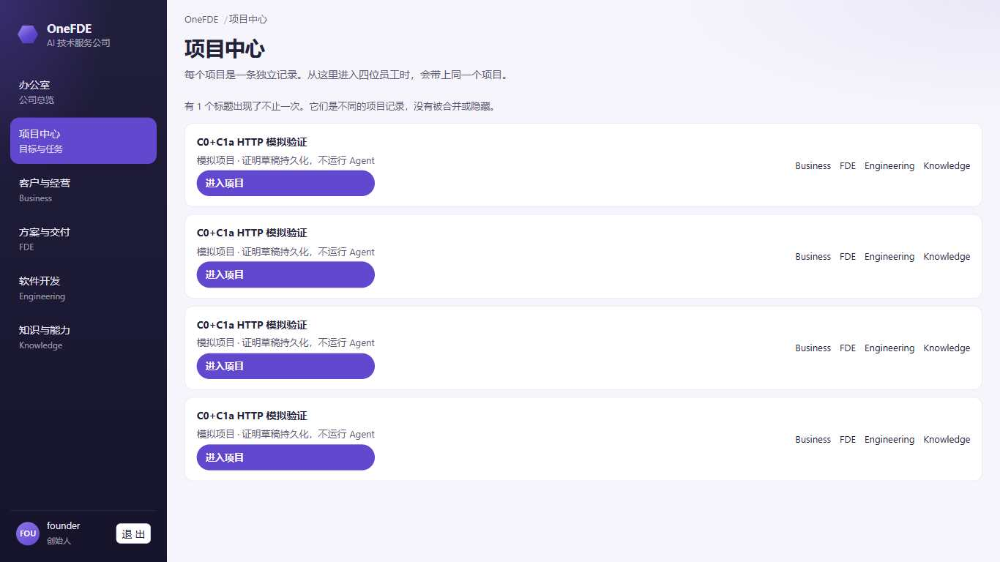

# OneFDE

OneFDE 是面向生鲜行业技术服务者的经营与交付工作台。创始人可以借助 AI 团队跟进门店需求、制定方案、推进开发和验收软件，并把经过验证的能力用到下一次交付。

以水果店为例，店主使用的是独立的报价工具。交付负责人在 OneFDE 里跟进这家店的需求、查看工程结果和检查记录，并决定是否接受交付。



## 从几份供应商报价，到一个能用的工具

一家社区水果店收到几家供应商的报价。苹果有不同等级和规格，蜜桔有的按公斤报、有的按箱报。店主想知道哪些报价可以直接比较，哪些还得问供应商。

1. **接到需求。** Business（客户经营）记录店主想解决的问题和报价来源，把需要继续确认的内容交给交付负责人。
2. **把需求变成可验收的任务。** FDE（交付）明确比较规则和完成条件。这个案例先比较商品、等级、规格相同的公斤报价，箱价和信息缺失的行留给店主核对。
3. **做出工具并检查结果。** Engineering（开发）实现 CSV 导入、比价和结果下载，提交可运行的版本及检查结果。负责人可以据此验收，也可以在原任务里提出修改。
4. **在下一次交付中复用。** Knowledge（知识）帮助团队查找已有的比价规则、实现和检查记录。「果采报价台」复用了已有的 CSV 比价逻辑，并对新页面重新做了检查。

## 本地体验

**先试店主看到的「果采报价台」。** 在仓库根目录执行以下命令，需要 Python 3。

```powershell
python -m http.server 8774 --bind 127.0.0.1 --directory products/mimo-fruit-quotes
```

打开 [本地报价台](http://127.0.0.1:8774/)，点击「载入模拟示例」和「比较报价」，再导出结果。示例使用模拟数据，比较在浏览器里完成。想先看界面，可以打开[报价结果截图](docs/operations/evidence/mimo-fruit-quotes-20261107.jpg)。

**再看交付负责人如何工作。** 按[工作台本地体验指南](docs/operations/testing.md#评委自助入口与示例故事2026-11-08)启动示例环境，查看需求、工程任务、检查结果和验收记录。

当前版本已在本地验证报价工具、工程验收和一次能力复用。公网体验和真实门店试点仍待验证。

## 了解更多

- [产品设计](docs/design/design.md) · 查看工作台页面和交付过程中的操作
- [系统架构](docs/architecture/architecture.md) · 了解角色如何分工以及任务如何流转
- [开发环境](backend/README.md) · 配置、运行和检查后端
- [验证记录](docs/operations/testing.md) · 查看已验证的场景和复现步骤
