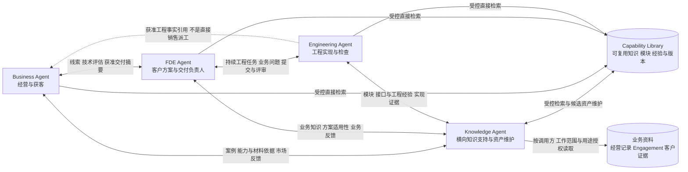

# OneFDE 首版推荐技术方案与架构

本稿连接 [PRD](../product/PRD.md)、[关键交互](../design/design.md)与[数据模型](data-model.md)。2026年11月4日C0+C1b持久控制、本地环境及Engineering真实网页提交/接受已有证据，见[CA验证](../operations/coding-agent-verification.md)；P1已落地薄FDE受控工具与交付详情API（`modules/fde`），尚无独立FDE模型循环。P2已有独立静态报价产品与FDE平台控制链（确定性Run回填，见[控制证据](../operations/evidence/p2-quote-control.json)）。P3已有文件型能力库条目与`modules/knowledge`受控检索/权限/Business交接，第二项目复用见[P3证据](../operations/evidence/p3-reuse-recheck.json)。真实模型Engineering与工作台前端仍未实现；无向量库。固定SDK边界见[ADR0006](ADR/0006-c2-worker-sdk-boundary.md)。下列组合是开发默认路线，推荐范围不等于已运行成果。

用户已确认[黑客松实施切片](../product/hackathon-proposal.md)，范围以PRD为准：优先薄FDE—Engineering—客户产品主链，再补三角色可查询的Knowledge与Business最小交接。复用现有Task/Input/Run、受控工具、固定SDK和单ECS+Compose边界；不增加四套常驻进程、通用图编排器或第五个协调模型。不能因现有owner_role=fde字段或工具白名单就称完整FDE Agent（含模型会话）已完成。

## 系统总架构图

OneFDE 由内部工作台、Backend、Agent 执行能力、持久存储和独立客户软件组成。下图展示逻辑职责与主要连接；Backend 内的方框是模块，不代表每个都要单独部署服务。四个角色是 Runtime 使用的运行配置，也不代表四个永久在线的进程。

```mermaid
flowchart TB
    Founder["创始人"] --> Web["OneFDE Web 工作台<br/>经营 · 客户项目 · 工程 · 能力"]

    subgraph Backend["OneFDE Backend：模块化后端"]
        API["API / Auth<br/>命令、查询、身份与权限"]
        Domain["Domain Service<br/>Engagement、证据、规则、交付、能力"]
        Tasks["Task Service<br/>持续任务、分配、输入、版本、评审"]
        Events["事件记录<br/>业务变化、执行记录、可补读通知"]
        Worker["Dispatcher / 独立 Worker<br/>派发、占用、取消、恢复"]
        Runtime["Agent Runtime<br/>上下文装配、模型循环、受控工具"]

        API --> Domain
        API --> Tasks
        Tasks --> Events
        Worker --> Runtime
        Runtime -->|受控业务请求与结果| Tasks
        Runtime -->|读取获准上下文| Domain
    end

    Web --> API
    DB[("PostgreSQL<br/>业务、Task、Input、Run、Review、Event、作业")]
    Domain --> DB
    Tasks --> DB
    Events --> DB
    DB -->|认领待派发作业| Worker

    Roles["四类角色配置<br/>Business · FDE · Engineering · Knowledge"]
    Roles -.-> Runtime
    Runtime --> Models["模型 API<br/>固定 ModelProfile"]
    Library[("Capability Library<br/>资产、固定版本、条件与实现引用")]
    Domain -->|资产元数据与受控访问| Library
    Runtime -->|检索或资产维护工具| Library
    Records[("业务资料<br/>经营记录、Engagement、原始证据与业务状态")]
    Domain -->|维护业务事实与归属| Records
    Runtime -->|按调用方与用途受控读取| Records

    Runtime -->|Engineering 工程执行| Sandbox["独立工程沙盒<br/>编辑、命令、构建、测试、预览"]
    Sandbox --> Git["Git / 任务工作区<br/>源码与版本"]
    Sandbox -->|实际结果与检查证据| Runtime
    Worker --> Objects["私有产物存储<br/>MVP本地不可变blob，跨机再接对象存储"]

    Tasks --> Publish["受控发布<br/>固定版本与发布权限"]
    Publish --> Product["独立客户软件<br/>首个案例：报价比较工具"]
    Customer["客户"] --> Product
```

读图时先看三条路径：创始人通过工作台管理工作；Backend 保存业务事实并安排 Agent 执行；工程成果经过检查和受控发布，成为客户使用的软件。Knowledge 是按需运行的服务角色，同时支持 Business、FDE、Engineering；Capability Library 是经过整理的可复用资产，业务资料是经营/客户项目的来源事实，两者分别保存归属、版本与权限，不是另外增加两个数据库。四角色的具体关系见下图；模型及工具不能直接决定权限或业务状态。

## 为什么这样分工

| OneFDE 实际需要处理的问题 | 对应设计及作用 |
| --- | --- |
| 需求今天讨论、明天继续，会换会话或执行进程 | Engagement 保存客户上下文，Task 保存持续工作；数据库使工作不依赖聊天窗口或 Agent 是否在线 |
| FDE 能判断方案，但运行状态/权限必须确定 | FDE 负责业务判断，Task Service 校验归属、范围、版本、输入采用与评审；模型通过受控工具提出操作 |
| 开发可能耗时较长，网页请求应及时返回 | API 先持久接单，Worker 再执行；页面刷新不取消后台任务，执行失败也不会阻塞全部 HTTP 请求 |
| 一项交付会反复提问、回答、修改和再检查 | 一个 Task 对应多次 Run，工程提交和业务接受分开；后续输入不会悄悄改变已运行快照 |
| 模型要调用工具完成工作，不只是生成一句回复 | Runtime 装配角色/上下文并驱动工具循环；四角色共享框架，各自取得适合的资料与权限 |
| 生成代码需要安装、运行和调试 | Engineering 在独立沙盒工作，平台数据库和部署凭据通过受控管理过程使用，不直接交给任意工程代码 |
| 项目状态、源代码和大文件的使用方式不同 | PostgreSQL 管关系/状态，Git 管代码版本，对象存储管文件/产物；数据库记录三者之间的引用与归属 |
| 客户软件要长期使用，开发环境可能随时回收 | 固定版本独立发布，客户入口与内部工作台、临时工程预览分开；可交付不依赖 Agent 一直运行 |

这些边界服务于一个小型交付闭环，不要求一开始建设大型基础设施。API/Auth、Domain、Task 和事件逻辑先放同一个后端代码工程；Worker 是独立进程，Runtime 是它使用的执行层。黑客松/MVP在同一ECS上以不同容器承载API/数据库、可信Worker和工程执行，不要求物理另机；具体服务、网络、配额和发布边界见[部署拓扑](../operations/deployment.md)。

Domain Service 与 Task Service 分开命名，是为了区分“客户业务依据是什么”和“某项工作正在怎样推进”。它们仍可共享数据库与事务。Dispatcher 的规则可以由程序确定，不需要第五个模型先重新判断 FDE 已明确指定的执行角色。

## 以报价工具理解一次完整流转

以下是设计示例，尚未运行。当前模拟规则仍以[项目记录](../../engagements/demo-supplier-quotes/brief.md)为准，不在架构里补定字段或换算精度。

1. 创始人录入“帮门店整理供应商报价”的目标和资料。Backend 建立 Engagement，FDE 读取证据并明确比较范围、未知项和完成条件。
2. FDE 检索能力库，决定复用哪些能力、哪些部分需要开发，提交“开发本轮报价工具”的 Task。Task Service 保存目标、owner/executor、规格与授权。
3. 经显式启动命令，Dispatcher 校验当前范围和执行占用，在数据库建立 Run 与待派发记录。Worker 认领后，让 Runtime 使用 Engineering 配置和工程沙盒完成文件、命令与检查。
4. 如果工程缺少具体业务规则，问题保存在原 Task。本轮确认停止、保存现场后结束；FDE/创始人答复并采用输入，再创建下一次 Run，可继续使用可信代码与 Session。工作仍是原 Task，不要求原 FDE 会话常驻。
5. Engineering 提交代码、构建和检查，Task 进入待评审。FDE/创始人接受固定版本或要求修改；只有接受后才完成业务任务。实际状态与判定条件见[数据模型](data-model.md)。
6. 具备对应发布权限后，固定版本独立发布并检查访问。三角色向 Knowledge 回传获准市场/业务/工程反馈，提炼候选资产；Business 可使用获准案例依据，FDE/Engineering 可在下一项目选用并重新检查，客户原始资料不自动入库或公开。

当前实施先做后端：先建立可持久读写的项目/任务和权限，再接 Worker、工程执行与持续反馈。工作台前端留到之后单独设计；图表示目标系统，不是要求同时实现全部方框。步骤及退出条件以[实施计划](../development/implementation-plan.md)为准。

## 架构目标与推荐

本地开发使用已授权的WSL2+Docker演示环境，见[ADR0007](ADR/0007-local-wsl-development.md)。云端黑客松/MVP以[ADR0009](ADR/0009-single-ecs-mvp.md)的单ECS一体化为准，替代必须另设执行主机的旧假设；环境检查不代表模型工程或单ECS公网验收已通过。

首版采用一个业务控制后端维护项目与任务，通过可替换适配连接模型、工程执行与部署。FDE 承担业务诊断、能力适用判断、方案和任务拆分；程序 Coordinator 承担权限、版本、依赖、去重、运行生命周期和结果归属。暂不增加第五个常驻 LLM Orchestrator，也不把平台后端直接作为任意代码执行宿主。

采用 OpenAI-compatible Chat Completions 形式的配置接入，Agent 运行复用 OpenHands SDK，工程使用 DockerWorkspace。工程工作区在Linux上的受限动态Sandbox容器内，挂载、工具/进程权限与控制数据分开；MVP物理同机。E2B 仅作后备，不与 DockerWorkspace 同时接入；采用上游示例完成一次接入冒烟，随后开发业务切片。

后端中的 Coordinator 是模块边界，不要求独立微服务。首版用一个 API 进程和一个有界执行 Worker 实现串行闭环；API与可信Worker是同ECS的独立Compose服务，Worker通过宿主DockerWorkspace创建无Socket的兄弟工程容器，四角色为按需运行配置而非四个常驻进程。Worker通过内部网络及受限服务身份访问数据库/私有产物，工程容器不继承这些权限；容器化Worker的路径/私网接线仍待实现。不增加自研远程 Runner 服务或开放 Docker TCP API；容器镜像和 Python 依赖锁定一致的 SDK 系列，不追踪 main 或 latest 浮动标签。

## 推荐技术组合

| 层次 | 首版采用 | 理由与边界 |
| --- | --- | --- |
| 前端 | React、TypeScript、Vite，Node.js 24 LTS 构建 | 内部 SPA，无 SEO/SSR 要求；不为 Python Agent 后端再增加 Next.js 服务 |
| 组件与交互 | Ant Design、React Router、TanStack Query | 复用表格/表单/状态组件、路由与服务端缓存；首版不引入 Pro 脚手架或第二套组件库 |
| 业务后端 | Python 3.13、FastAPI、Pydantic 2 | 与 OpenHands Python SDK 同语言；HTTP 请求校验与 OpenAPI 由类型模型维护 |
| 事务与迁移 | SQLAlchemy 2.1、psycopg 3、Alembic | 应用和 Worker 使用同一领域服务与迁移；数据库会话按请求/作业创建，不跨线程共享 |
| 业务存储 | PostgreSQL 17 | 保存项目、任务、运行、幂等和待派发记录；开发/测试同数据库类型，首版不以 SQLite 模拟关键锁语义 |
| 文件与日志 | MVP私有本地不可变blob及持久卷 | DB保存摘要/归属；异机备份另授权，跨机执行时再接对象存储，不增加MinIO前提 |
| Agent 与模型 | OpenHands SDK、其内置 LiteLLM 适配 | 四角色使用角色化配置/工具集，Engineering 才有工程终端；不额外引入 LangGraph、独立网关或自研 Harness |
| 调度 | PostgreSQL 待派发记录与独立 Python Worker | 一次持久接单、事务外执行；首版一个活动工程 Run，不新增 Redis/Celery |
| 进度读取 | REST 查询与短轮询 | 页面可见且任务活动时约 2 秒刷新，终态停止；SDK 内部事件仍消费，但不首发自建 WebSocket/SSE 推送层 |
| 登录 | 单创始人账号、服务端 Cookie 会话、CSRF token | 无注册、多租户或 SSO；平台密钥不发给前端，登录配置和发布权限保持独立 |
| 部署 | 单台阿里云ECS、Linux、Docker Compose、Caddy | API/PG/Worker/Agent Sandbox/站点同机，服务/权限/资源分开；客户产品独立版本，不复用工程容器 |
| 开发与检查 | uv、pnpm；pytest、Vitest、Playwright | 依赖与锁文件随实现产生；控制逻辑用确定性测试，少量真实端到端验收，不跑全量上游测试 |
| 首个客户报价工具 | 独立 React 静态应用、SheetJS Community Edition | 浏览器解析结构化文件；同一库承接 Excel/CSV，不先加客户服务端；文件类型范围与导出格式按项目规则确认 |

C0+C1b后端与数据库已有安装锁和运行证据；C2通过可选worker extra锁定SDK/workspace/tools 1.59.0及Agent Server镜像digest，但真实执行仍未验证。其余组合仍为推荐。SDK要求Python >=3.12，仓库使用Python3.13；不独立升级Pydantic/LiteLLM破坏发布组合。绑定、限额与具体取舍见 [ADR0006](ADR/0006-c2-worker-sdk-boundary.md)。

React 官方说明 Vite 路线仍需自行选择路由与数据获取；本项目明确采用上述库，不自行造框架。[React 说明](https://react.dev/learn/build-a-react-app-from-scratch)、[Ant Design](https://ant.design/docs/react/introduce/)、[TanStack Query](https://tanstack.com/query/latest/docs/framework/react/guides/important-defaults)

FastAPI 以 OpenAPI/Pydantic 配合 Python API，SQLAlchemy 和 Alembic 分别管理事务与迁移。[FastAPI](https://fastapi.tiangolo.com/features/)、[SQLAlchemy 事务](https://docs.sqlalchemy.org/en/21/orm/session_transaction.html)、[Alembic](https://alembic.sqlalchemy.org/en/latest/)

## 组件与边界

Backend 是模块化业务应用，Coordinator 是此前对程序协调职责的总称，现在落实为 Task Service 和 Dispatcher 等模块。共享代码与数据库，不为模块名创建独立微服务；模型不直接管理数据库状态。

| 模块 | 职责与输出 | 首版取舍 |
| --- | --- | --- |
| API/Auth | 创始人 HTTP 命令/查询、认证、CSRF、幂等 | 不开放可伪造角色的公共 Agent API；Agent 用受控工具调用领域服务 |
| Domain Service | Engagement、证据/规则、交付引用和能力元数据 | Business 经营资料不强制建客户项目，Opportunity 完整销售流程后置 |
| Task Service | 持续 Task、owner/executor、后续输入、版本、授权和轻量业务评审 | 负责人/执行者字段与历史足够，不先建转派系统或通用审批引擎 |
| Dispatcher | 可执行检查、Run/作业登记、占用、取消/重试/恢复归属 | PostgreSQL 直接消费，一个活动工程 Run，待输入时释放已停止的执行占用 |
| Agent Runtime | 按角色装配上下文、调用 OpenHands、受控工具、结构化结果 | SDK 提供模型循环，OneFDE 只实现角色工具与业务适配，不重写 ReAct 框架 |
| 事件记录 | TaskEvent 与 run_events、结果回填、页面可补读通知 | 同事务数据库记录，不新增外部总线、Redis、Outbox Relay 或常驻通知 Agent |

上图是角色协作关系，不是进程网络图。双向箭头表示请求/支持和反馈；工程事实虚线是已有证据的获准引用，不授予 Business 直接修改客户工程的权限。业务资料与库查询、候选维护、长期派工仍经 Backend/Runtime 受控工具执行。六组关系的职责边界以[PRD](../product/PRD.md)为准。

Knowledge 服务覆盖经营、客户方案和工程三个方向，不只是交付结束后的总结。Business 可请求获准案例/能力/材料依据，FDE 可请求规则与复用适用性支持，Engineering 可请求模块/接口/工程经验；三者回传反馈供候选整理。简单读取可直接走权限相同的检索工具，分析比较才调用 Knowledge。咨询结果不自动改写业务来源、采用新规则、提升资产验证状态或获得公开权限。

短调用用于有界、无需独立生命周期的能力：检索优先直接工具，专业短分析可调用角色化 Agent，限制调用深度、次数/时长、项目权限和总预算，记录父 Run 与结果；禁止双向递归委派。开始等待业务答复或独立交付时转正式 Task，父 Agent 不靠阻塞调用长期等待。Engineering 对 FDE 的问题优先记录原 TaskInput；只有回答本身需要独立工作时再建关联 Task。

OpenHands TaskToolSet 已提供阻塞子 Agent 和 Session 续用，但 SDK task ID 不是 OneFDE 的业务任务。官方工具实现由 TaskExecutor 调 TaskManager.start_task；可借鉴有界咨询和上下文分离，不用它代替长期数据库任务。[官方文档](https://docs.openhands.dev/sdk/guides/task-tool-set)、[原始执行器](https://github.com/OpenHands/software-agent-sdk/blob/main/openhands-tools/openhands/tools/task/impl.py)

业务负责人保持 fde，工程执行者 engineering；Engineering 不接受自己的业务提交。FDE 可建议接受，Task Service 校验固定版本与证据，创始人可代行评审；生产发布仍按独立权限执行。能力整理默认候选，Knowledge 不自行将未验证资产升级成可复用事实。

显式命令不等于每步都要创始人点击：角色工具可在已授任务范围与额度内提交继续/运行请求，由程序校验；新商业范围、额度提升和正式发布回创始人。C 初期人工代行所有者是实施顺序，不是长期要求人监督所有内部动作；本轮不引入主动监听或自动触发来源。

## 四个 Agent 的运行配置

设计或修改Engineering的上下文、工具、工程检查、提交和续作时，读取[Coding Agent细化设计](coding-agent.md)；直接复用/自有适配/后置范围及上游版本差异见其中清单与[参考依据](coding-agent-research.md)。本轮只细化设计，未新增执行能力、模型调用或HTTP契约。

四类 Agent 共用 Runtime 和模型接入能力，每次运行组合“角色规则、受控上下文、工具白名单、模型配置及限额”，输出结构化结果、问题或工作请求。角色不等于一个永久进程或一个全局 Session；同一角色服务不同工作时取得各自范围内的资料。职责和业务产出以 PRD 的角色表为准，这里只维护运行边界。

| 角色 | 上下文组织 | 工具与输出边界 |
| --- | --- | --- |
| Business | 公司经营资料、指定线索、获准案例/交付摘要及对应知识答复 | 公开研究、受控资料/能力检索、Knowledge经营咨询、材料和可行性请求；无工程终端或全客户资料权限，不自行承诺 |
| FDE | 指定 Engagement 的证据/规则、能力候选、相关 Task 与评审结果 | 诊断/检索、提交候选任务、答复、采用输入与评审工具；关键商业或发布权限回创始人 |
| Engineering | 固定 Task/Run 快照、代码基准、前置产物、能力版本与获准咨询结果 | 工程终端/编辑/检查、能力库工具、Knowledge工程咨询和受控发布；业务规则/范围问题回FDE，不自接受提交 |
| Knowledge | 实际请求方/用途/受众/工作归属、经权限过滤的经营/业务/工程来源与资产版本 | 为Business/FDE/Engineering检索分析、解释比较和给出建议，整理三者反馈；可见范围不超过调用方有效授权，不自行确认业务/公开/发布或验证状态 |

角色 Session 与当前工作关联；恢复时可加载可信历史，也可从业务记录和代码重建所需上下文，不默认复制整个项目聊天。FDE 委派工程后本次会话可结束，Engineering 问题或结果依靠 Task 继续交接。四角色业务交接图表达职责关系，实际长期协作由 Backend 持久协议承载。

Knowledge 的请求/返回、业务资料与资产的分界、来源继承和公开用途权限只在[能力库约定](../../capability-library/README.md)维护。三个角色都可直接咨询，身份/用途由 Backend 保持，先过滤输入再核对输出与引用；Knowledge 不是能绕开调用方权限的全知账号。咨询可关联已有父 Run；Business 尚无 Task 时记录实际经营请求，不虚构项目。短咨询不创建工程写入者，长整理走任务协议；公司级/非工程任务入口仍按阶段扩展，不改当前已实现工程 HTTP 契约。

同一 Runtime 框架不要求所有模型流量经过独立网关；ModelProfile 映射 SDK 既有客户端。角色工具结果保留调用归属，但不能因进程共享就共享全部上下文或密钥，工程代码仍不获得控制数据库凭据。

## 普通请求与派发

1. 入口记录原请求与项目/Task 身份；已有明确 task_id 时不再交给 LLM Router 重新猜归属。归属不明才由 FDE 提建议，关键歧义澄清后再写入。
2. FDE 读取有来源的项目证据，检索能力，提出交付策略和 Task。模型提出的范围和依赖仍须通过程序与业务确认状态校验。
3. Coordinator 核对任务版本、输入、依赖、授权、模型能力和资源限额；在事务内认领、建立 Run 与待派发记录。
4. 执行 Worker 从持久待派发记录启动，按固定 ID 调用执行器；重启后能继续处理，不依赖 HTTP 请求保持连接。
5. 工程执行器创建或恢复指定会话与工作区，传递上下文清单，只开放任务所需工具。实际状态和结果按 runId、版本与序号回传。
6. 工程提交进入业务 review；问题进入 waiting_input，结束当轮 Run 并保存现场。回答/修改先记录、后采用，再建新 Run；FDE 评审固定产物，程序才确认 Task 完成。部署访问另核查，Knowledge 按明确任务整理候选资产。完整状态仅在数据模型维护。

PostgreSQL 中的 dispatch_jobs 与 Run 在同一事务内写入；Worker 通过短事务锁定/认领作业，提交后再调用 SDK。可使用 FOR UPDATE SKIP LOCKED 处理队列消费者，不能用它跳过业务一致性检查；长模型/命令执行不持有数据库行锁。[PostgreSQL 锁说明](https://www.postgresql.org/docs/17/sql-select.html)

不使用 FastAPI BackgroundTasks 承担需要持久运行的 Agent 作业。HTTP 只登记并返回接单结果；后台线程/事件循环任务本身不能替代数据库记录与独立 Worker。[FastAPI 后台任务边界](https://fastapi.tiangolo.com/tutorial/background-tasks/)

外部操作在事务外执行，采用稳定操作 ID 与回执核查；数据库提交不会回滚已发生的云端发布。作业租约过期时先标记状态不明并核查工作区，不自动重开正在写入的工程任务。

后续输入接收与执行分开：保存 pending 不表示当前模型已采用。MVP 在当前执行段结束或显式 stop_for_update 确认停止后，由所有者应用输入；不依赖任意命令中的热更新。已关闭工作另建关联 Task，未关闭交付中的修改延续原任务。一个 Run 是执行段，不要求等于一个 SDK Session。

任务、输入/评审和 TaskEvent 同事务保存，需要执行时同时写 dispatch_jobs。Worker 直接消费同库作业，暂不存在“先写业务库、再发 Redis”双写；将来采用外部消息代理时才加 Outbox Relay 与幂等消费者。事件记录也不等于整套 Event Sourcing。[Outbox 模式适用边界](https://docs.aws.amazon.com/prescriptive-guidance/latest/cloud-design-patterns/transactional-outbox.html)

队列锁失效会触发恢复，但无法证明旧执行进程停止；这是使用 BullMQ 等成熟队列时仍需处理的应用责任。因此当前串行方案先保留 interrupted 核查，不引入仅在数据库存编号却无法拦住旧 shell 的“假 fencing”。[BullMQ stalled 机制](https://docs.bullmq.io/guide/jobs/stalled)

## 模型 API 兼容策略

API 兼容可以做到，但应区分四层：连接可达、请求格式兼容、工具循环可执行、具体工程任务有效。只完成普通文本回复不算工程模型验证通过。

ModelProfile 记录 provider、protocol、base URL、model ID、secretRef、能力和适配参数；角色引用配置，Run 固定配置修订。首轮先支持兼容 Chat Completions 的必要子集，不承诺所有厂商或协议自动互换。其他协议通过明确适配加入，不让业务代码直接依赖厂商参数。

| 能力 | 接入需要支持的内容；自定义差异或失败时追加检查 |
| --- | --- |
| 消息和工具 | system/user/assistant/tool 的受支持形式、工具参数与 tool_call_id 的正确往返 |
| 连续调用 | 至少跨多个工具轮次继续任务，不只验证一次 function call |
| 流式输出 | 工具参数增量拼接、正常结束和错误中断，客户端断线不导致重复执行 |
| 结构化结果 | 输出 schema 校验、错误重试上限；模型未满足结构时不能直接写任务状态 |
| 上下文恢复 | 必须保留的协议扩展和工具历史可正确重放；压缩后不破坏关联 |
| 限制和成本 | 明确上下文/输出上限、超时和调用额度；无法可靠计费时先用次数及 token 等硬界限，不虚构费用 |

OpenHands 官方 LLM 类提供 base_url、model、native_tool_calling 等配置，并通过 LiteLLM 接入；这支持路线可行性，但不能证明特定模型与所选 SDK 版本已兼容。[OpenHands LLM 参考](https://docs.openhands.dev/sdk/api-reference/openhands.sdk.llm)

MiMo 官方集成示例使用 OpenAI-compatible 配置；其部分模型的多轮思考工具调用涉及 reasoning_content 等扩展。因此适配不能丢弃提供者要求的协议字段，也不能把一个模型的参数假定适用于全部模型。原始协议内容按运行需要受控保留，不全部灌入产品界面。[MiMo 官方集成示例](https://github.com/XiaomiMiMo/awesome-mimo-agent/blob/main/docs/oh-my-pi.md)、[MiMo 官方模型说明](https://github.com/XiaomiMiMo/MiMo-V2-Flash)

首版不额外部署 LiteLLM Proxy，直接使用 SDK 内既有 LiteLLM 适配。Business/FDE/Knowledge 也通过角色化 Agent 配置调用相同接入层；工具只允许读取对应资料、检索能力、提交候选任务或候选资产。创建运行、提升资产状态和发布结果由应用服务校验，不由模型直接改数据库。模型调用不支持的参数显式适配，不静默把工具调用改成不受控文本执行。只有多用户密钥、统一配额或多个应用共同访问成为实际需求时，再评估独立网关。[兼容端点文档](https://docs.litellm.ai/docs/providers/openai_compatible)

## 执行环境比较

| 候选 | 参考价值与代价 | 当前推荐 |
| --- | --- | --- |
| 直接在开发机运行 | 最容易尝试，但生成代码和凭据/个人文件容易混用，恢复也依赖本机 | 不作为默认工程执行路线 |
| OpenHands SDK 与 DockerWorkspace | 官方提供 Agent Server、容器生命周期与远程 Conversation；部署者仍负责挂载、网络、资源与宿主权限 | 本轮首选，同ECS受限动态容器及固定镜像；可信Worker与Sandbox权限分开，接入时短冒烟 |
| OpenHands Cloud Workspace | 托管执行可减少运维，但需核对账号、区域、限额、费用与数据路径 | 自管运维负担过高时比较，不默认开通 |
| E2B | VM 型沙盒及网络、生命周期控制明确；与所选工程 SDK 的适配、产物保存和成本须另验 | 后备候选，不假定即插即用 |
| 自研完整 Harness | 灵活但需自行处理工具循环、恢复和会话协议 | 首版不优先 |

DockerWorkspace 已有官方示例；容器结束可清理运行环境，因此源码、必要日志、运行证据和可恢复资料必须在回收前保留。[OpenHands Docker Sandbox](https://docs.openhands.dev/sdk/guides/agent-server/docker-sandbox)

容器隔离是否有效取决于实际配置。生成代码不取得 Docker daemon socket、宿主敏感目录或平台数据库凭据；限制用户权限、挂载、CPU/内存、出网、运行时长与并发。MVP共享物理宿主，但Docker管理权限只给可信Worker，工程容器不取得控制数据；不把不同目录/普通容器称为强敌对租户隔离。[Docker 官方安全说明](https://docs.docker.com/engine/security/)

E2B 的沙盒有暂停/恢复/终止与连续运行边界，默认可出网并可配置限制；若改用它，仍须核对回收、出口和产物持久化。[生命周期](https://docs.e2b.dev/sandbox)、[网络控制](https://docs.e2b.dev/network/internet-access)

OpenHands 的 API-based Sandbox 页面注明其 Runtime API 主要面向 benchmark；不把该评测入口作为生产平台默认执行后端。[官方说明](https://docs.openhands.dev/sdk/guides/agent-server/api-sandbox)

## 发布与长期运行分离

平台控制服务、工程执行环境与客户软件入口具有不同生命周期。工程容器中的预览可以用于检查，但不是默认的长期交付。客户工具发布时固定代码/构建版本，记录外部操作回执与实际访问结果。

平台后端与 Worker 使用 Compose 管理的长期进程。首个报价工具推荐独立的 React 静态应用，在浏览器解析已约定的结构化文件并比较/导出，文件不必上传平台；这减少服务端托管与客户数据留存。文件大小/兼容/计算要求超出浏览器能力时再增加独立 Python 服务，不把 OneFDE 平台数据库当作客户报价数据库。客户端处理是技术建议，业务字段与换算规则仍按项目确认。

用户最新指定单ECS一体化部署整个OneFDE及客户产品，见[ADR0009](ADR/0009-single-ecs-mvp.md)。独立发布指站点、版本、运行配置和权限独立，不要求每产品或每角色独占服务器；正式产品不复用可写工程容器。具体服务、域名、受控发布、备份与资源估算仅在[部署设计](../operations/deployment.md)维护，分阶段验收见[单ECS计划](../operations/single-ecs-verification.md)。本地S1/S2已按授权适配并验证，详见单ECS计划中的逐项证据；未购买ECS或公网部署，完整生产拓扑尚未落地。

结构化表格解析推荐 SheetJS CE，初始化时按官方发行源固定版本并记录完整性信息，不将旧 registry 包或运行时 CDN 浮动脚本当默认依赖。只读取约定数据单元格，不执行宏或假设能重新计算工作簿公式；公式/缓存值如何处置及具体 Excel 兼容范围在 D 的输入规则中明确。[SheetJS 官方安装说明](https://docs.sheetjs.com/docs/getting-started/installation/frameworks/)

部署凭据按目标与环境限定，由受控发布操作使用，不直接作为通用 shell 环境变量交给任意生成代码。需要签发真实凭据、开放公网或产生费用时再落实配置与金额上限；本稿不授权付费资源创建。

## 失败与恢复

Coordinator 按[状态模型](data-model.md)处理超时、取消和失联。网络断开只说明暂时看不到执行，先核对执行器和工作区；不能立即对同任务启动第二个写入者。外部部署等副作用按操作 ID 查询既有结果后再重试。

模型 429/暂态服务错误可有界重试；输入错误、权限错误、业务规则缺失需要修正或澄清。重试策略在所有层共用总预算，避免 SDK、应用和任务三层分别重试造成放大。限额未设置时不启动外部验证；数值在验证前确定，不把“按推荐来”解释为无限预算。

## 阶段 C 接入与实现检查

上游已有真实模型集成测试、文件操作测试和 DockerWorkspace 示例。直接复用其能力，在实际接入时用一个小任务确认当前配置；不单设一轮重复验证工具执行、容器或 API 兼容存在性的预研。任务幂等、运行归属、业务规则等自有逻辑在开发中做针对性检查；基本持久化保留，广泛故障注入、通用 DAG 和并发压力测试按实际需要后置。修订后的安排见[实施计划](../development/implementation-plan.md)。

上述完整执行/恢复链路尚未实现或运行；C0+C1a 后端已本地检查。模型/账号、SDK精确依赖、执行额度和域名仍为后续接入配置项。关键选择记录在 [ADR 0001](ADR/0001-coordination.md)、[ADR 0002](ADR/0002-model-compatibility.md)、[ADR 0003](ADR/0003-execution-validation.md) 和 [ADR 0004](ADR/0004-platform-stack.md)。

最小 HTTP 契约见 [openapi.yaml](openapi.yaml)，物理映射与状态不变量见[数据模型](data-model.md)，环境边界、发布和回退见[部署设计](../operations/deployment.md)。当前 YAML 是设计稿；实现后由 FastAPI/Pydantic 生成并导出同一路径，生成结果与文档保持一致，不长期维护两套字段定义。

## 已落地的代码组织

C1b后按业务模块拆分到backend/src/onefde，入口与基础设施分开，Run/Input/评审仍围绕Task保持事务一致性。详细入口见 [代码组织](../development/code-structure.md)，决定见 [ADR0005](ADR/0005-backend-code-structure.md)。只改变Python包/文件位置与依赖方向，没有新增业务接口、表结构或C2执行能力。
