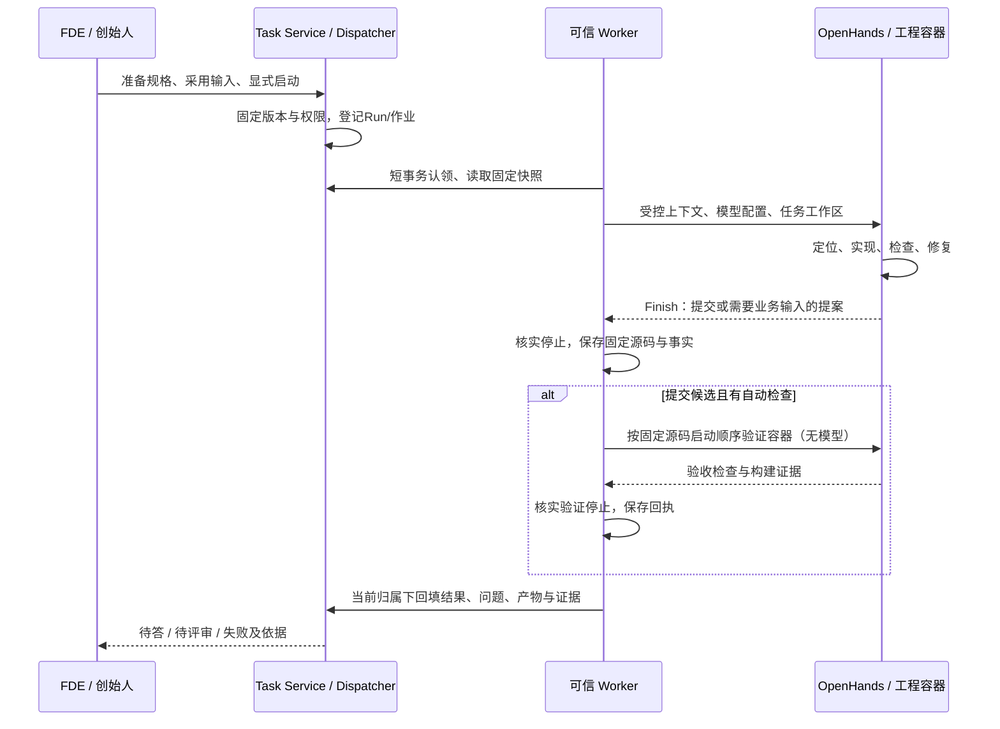

# Coding Agent 设计与复用边界

2026年11月4日设计基线；同日已实施上下文/结果契约、工作区比对与固定源码验证，并在 DeepSeek 授权后完成真实网页冒烟（见[验证记录](../operations/coding-agent-verification.md)）。Coding Agent 对应 Engineering 角色；需求依据为[PRD](../product/PRD.md) P05—P08/P10。

调整工程上下文、工具、检查、提交或续作时读取本文。对象/状态以[数据模型](data-model.md)为准，权限/网络/发布以[部署设计](../operations/deployment.md)为准，知识服务以[能力库约定](../../capability-library/README.md)为准；本文只维护 Engineering 执行设计。[上游依据](coding-agent-research.md)记录参考来源与版本差异。

## 设计选择

继续使用 OpenHands SDK 驱动模型与工具循环，DockerWorkspace 承载工程工具。OneFDE 负责把已授权的持续 Task 转成有界 Run，装配上下文、保存事实、检查提交并交回 FDE。首版单 Engineering Agent、单活动工程 Run；验证容器同样占用该名额，四角色无需常驻。FDE 做业务诊断与评审，Backend 做确定性控制，不增第五个协调模型或独立 QA Agent。

### 直接复用、自己实现与后置

“直接复用”指调用锁定依赖的公开能力，仍需完成配置与本项目接入检查；“自有适配”指 OneFDE 维护的薄代码，不包含重写 SDK。下表状态是本轮开始时的代码事实，未来实现逐项更新。

| 能力 | 处理方式及责任 | 当前状态 / 实施时点 |
| --- | --- | --- |
| 推理、工具往返、事件与 Conversation | 直接复用 OpenHands Agent/Conversation；模型接入沿用内置 LiteLLM | 固定1.59.0已接线，真实模型未验证；C2 |
| 终端、文件编辑 | 直接复用 TerminalTool/FileEditorTool；搜索、Git、构建和测试先由终端调用仓库工具 | 已接线；不另建文件编辑器/搜索引擎；C2 |
| 工程容器与远程执行 | 复用 DockerWorkspace/Agent Server；安全参数、网络、路径、停止确认由自有适配负责 | 本地无模型已验证；单ECS差距按部署计划实施 |
| 持续工作、输入采用、版本、派发、评审 | 自有 Task Service/Dispatcher，SDK task ID不作业务身份 | C1b/C2控制已实现，薄FDE待接；C3 |
| 工程上下文与角色规则 | 自有上下文清单/来源过滤/版本摘要，通过SDK AgentContext.system_message_suffix装配 | 已实现清单/角色修订/检查表；pending不作新授权；C3 |
| 仓库定位 | 借鉴Aider按相关性提供代码上下文，先目录/入口/关键文件按需读 | 终端可执行查找；自动仓库地图后置，出现定位/上下文瓶颈再评估 |
| 修改—检查—修复 | 借鉴Aider反馈闭环，执行仍用SDK循环；项目命令从实际配置确认 | 登记自动检查与提交门槛已实现；真实模型修复循环待测；C3 |
| 提问与工程提交 | 自有类型校验、证据归属和领域回填；复用SDK Finish消息承载提案 | 类型化Final+自动检查匹配已实现；无效JSON/无关exit 0拒绝；C3 |
| 源码、日志与产物 | 自有归档、摘要、来源与保留策略；Git命令沿用现有工具 | 源码快照排除 `bash_events/`；新增源码不能靠忽略 `added` 通过验证；Git基准后置 |
| Knowledge/能力库查询 | 自有身份/用途过滤与有界查询，通过SDK工具扩展连接 | 工程端尚未接入；D/E按实际需要接，不阻塞C2 |
| 会话历史与压缩 | 复用SDK持久化；需要压缩时采用锁定版本condenser | 每Run新Conversation已实现；condenser关闭，长任务出现实际需求再启用 |
| 成本、截止与取消 | SDK提供迭代/费用参数；自有Worker截止、停止核实、租约与回填 | 已有控制；提供方费用/真实停止延迟待实测，不能称硬封顶 |
| 多Agent开发/独立审查/自动发布 | 后置；先用确定性检查和FDE业务评审 | 当前不接TaskToolSet子Agent、不启critic、不建通用DAG或发布Agent |

直接依赖仅延续OpenHands组合；Aider和mini-swe-agent作为设计参考，不安装为第二套Runtime，不复制其源码。若后续引入代码或依赖，先记录固定版本、许可证和适配维护成本。

## 一次 Run 的执行顺序

业务事务只包认领、资源登记、续租、结果等短操作，不跨模型或命令执行。图中顺序验证为C3/D设计，不改变C2既有最小冒烟标准；运行状态、停止竞态与迟到结果仍由数据模型判定。

### 1. 派工与预检

FDE明确目标、范围、已确认规则、输入引用及可观察验收条件；商业未知项留给所有者，技术实现细节由Engineering选择。Backend校验Task版本、pending输入、权限、依赖支持程度、模型修订、预算和全局占用。当前依赖未实现时继续拒绝非空dependencies。

Worker在创建资源前解析凭据并核对环境；环境/模型配置不足返回技术阻塞，不伪造业务问题或执行成功。完成标准：Run能关联不可变规格、授权和原请求，执行器取得的内容可追溯。

### 2. 装配工程上下文

推荐清单由可信代码产生，分为控制记录和发给模型的可见部分。以下为内部设计项，不是新增HTTP字段或已实现Pydantic模型；实现时在既有执行端口/Run快照内按需演进，不预建通用上下文服务或新表。

| 清单内容 | 来源与装配规则 | 当前差距 |
| --- | --- | --- |
| 身份与版本 | Engagement/Task/Run、spec_version、原请求引用；程序注入owner/executor | 清单 `spec_version` 取该 Run 固定的 `task_spec_version`，不从规格正文猜，也不留空。旧快照没有该键时，认领只在执行副本上补入，不改已保存的 snapshot |
| 目标与验收 | 固定spec、范围/非目标、编号验收条件及确认来源 | `spec.inputs` 是任务输入；`non_goals` 只接受规格里的非目标。`[auto]`/`[check]` 映射自动检查，其余为业务评审 |
| 已采用输入 | 固定applied_input_ids、回答对应问题与证据版本 | 已发送已采用输入；pending只作控制提醒，不作新指令 |
| 代码起点 | 仓库/分支/基准提交；续作时上一轮源码摘要、未提交diff与可恢复状态 | `prior_source` 取最近一次已确认停止的 completed 或 failed 源码归档。interrupted 不能当基准；工作区与该归档不一致仍 `WORKSPACE_DRIFT`。Git基准后置 |
| 工程入口 | 受信任选定的开发约定、目录说明、依赖锁与实际构建/检查入口 | Agent可自行读文件；受控筛选仍可加强 |
| 前置产物/复用 | 有效的已接受版本、获准能力版本、适配限制；读取时重新校验权限 | D/E启用，缺失时明确无可用项 |
| 历史与问题 | 最近失败/检查事实、尚待解决的问题、上轮摘要；保留来源Run | prior_failures写入快照；完整摘要仍可加强 |
| 运行配置 | 模型修订、角色规则修订、工具白名单、SDK/镜像、限额和清单摘要 | 角色/上下文修订已固定；密钥仅保留secretRef |

保留OpenHands默认工程指令，优先通过固定版本AgentContext的system_message_suffix等扩展加入Engineering规则；角色规则固定修订，职责包括范围内自主实现、实际检查、业务疑问回FDE及按契约提交。最终接线按锁定SDK类型核对，不整段替换上游system prompt。

客户源码、附件、网页以及其中的AGENTS/Skills/提示词作为资料。项目开发约定由可信装配层选定后提供，只有既有授权范围内的规则有效；不自动加载宿主用户或公共Skill。读取资料不能扩大工具、网络、发布或其他项目权限。清单摘要用于追溯，不能代替数据库授权。

受信 Engineering 技能由后端包内固定清单提供，核对摘要后通过 AgentContext 和原生 invoke_skill 按需加载。每轮保存实际提供的正文、来源版本和成功工具调用证据；独立验证与业务接受保持原门槛。首批内容、记录位置与验证入口见[技能运行约定](../operations/engineering-skills.md)。

上下文按“固定任务摘要 + 目录/入口 + 按需文件”展开，控制大日志和无关文件。模型可用终端定位实现，不把整个Engagement聊天或全部仓库塞进首条消息。压缩后仍从固定清单恢复目标/规则/验收/权限，摘要只是派生内容。完成标准：同一Run的输入有来源，新增pending输入和客户资料中的指令均不成为新授权。

### 3. 工具与自主执行

| 操作 | 执行位置与身份 | 首版行为 |
| --- | --- | --- |
| 读写任务文件、搜索、Git diff、安装获准依赖、构建/测试/临时预览 | 工程容器，SDK终端/编辑工具 | 在范围和限额内自主完成；依赖网络和命令按实际环境能力执行，失败保留事实 |
| 提业务问题 | Finish needs_input提案，经可信Worker调用Task服务 | 写原Task问题；保存现场、确认停止后释放占用，等待FDE回答并采用 |
| 提交成果 | Finish submitted提案，经可信Worker校验与回填 | 绑定固定源码和检查，不直接接受Task或发布 |
| 检索资料/咨询Knowledge | 后续受控工具；Backend注入实际身份、Task/Run、用途与预算 | Engineering可直接咨询；客户规则确认仍回FDE，查询本身不改spec |
| 接受输入、修改规格、接受业务提交 | FDE/创始人通过现有领域命令 | 不放入Engineering工具集 |
| 正式发布、增额度、扩大商业范围 | 单独授权的受控操作 | 工程容器无平台/生产凭据；发布协议沿部署设计，当前不接自动发布 |

不为每次编辑/测试增加人工确认。默认工程容器只取得本Task工作区与本Run Session，不取得Docker Socket、控制数据库、Worker私密文件或其他项目目录。出网、资源和创建时硬化沿[单ECS验收](../operations/single-ecs-verification.md)，不由提示词代替。

后续Knowledge工具使用SDK的Action/Observation/Executor扩展。Sandbox只获短期、绑定Run和允许操作的窄凭证，Backend每次校验实际归属/有效授权/预算，停止后撤销；不提供通用HTTP代理或SQL工具。允许的查询入口也需单独配置网络。具体传输接线在D/E切片实现时确定；当前Final回填路径无需建设双向工具网关。

### 4. 检查与修复

Agent先读实际README、锁文件和脚本，选择与改动相关的检查；功能变化补能验证行为的用例。执行失败后将命令结果送回同一SDK循环修复，受统一时间/迭代/费用限额约束。已有失败与本轮引入的失败分开记录；修改验收用例须说明理由并留diff，不以删测试换通过。

自有证据采集按SDK事件关联action/observation，保存实际命令、工作目录、退出码/超时、日志受控引用、所属Run和源码版本；长日志存私有文件，页面只读摘要。命令输出仍是工程数据，可信记录证明“实际执行及返回”，业务正确性还需验收样例与评审。

当前capture仅保存终端退出码；任意一次exit 0（例如列目录）不能满足未来的工程提交检查。推荐验收条件清单逐项给出检查类型、来源和证据：自动检查或业务评审；必需自动检查必须通过，业务评审项在工程提交时标为待评审。

**固定版本验证（已实现，无模型替身已覆盖本轮缺陷）**：Agent结束后先确认其工程容器停止，保存源码摘要。可信Worker把该固定源码复制到新的顺序验证工作区，复用DockerWorkspace执行预先登记的检查命令，不加载模型。验证收到停止信号和本 Run 的总截止时间：已经取消或已经超过截止时，不创建验证容器，也不执行后续检查；正在执行的检查在停止信号或截止到达时受控停止。新增、删除、修改的源码成员都不能通过；只有明确排除的工具日志目录 `bash_events/` 不计入比对。未列入该目录的构建输出或其他新文件都算源码变化。归档仍排除既有的 `.git` 元数据，这不是放行任意新文件的例外。验证容器按相同挂载/网络/资源约束，登记为 `validation` 角色。初始化、执行或清理若抛错，必须汇总全部所属容器的停止状态；任一无法确认则为 interrupted，`stopped=false`，不释放执行名额。

该步骤复用容器机制、自己实现检查编排，不建新服务或第二个Agent；所有容器均归当前Run，`runtime_ref.resources`可同时登记 engineering/validation。未知现场仍保持interrupted。验证失败保留源码/日志并按技术失败返回；获授权后新Run修复，不在已停止的旧Run偷偷恢复写入。已确认停止并保存了可信 `source-snapshot` 的失败 Run 可以作为下一轮修复基准。

完成标准：每个必需自动检查关联当前固定源码和真实结果；文档任务按其适用的链接/状态检查验收，不强制无关构建；客户软件按任务要求执行构建、启动与核心功能检查。测试环境替身仅证明自有控制逻辑。

### 5. 结果提案、可信回填与业务评审

复用固定SDK的FinishAction.message，OneFDE解析并校验结果；固定1.59.0的FinishTool不接受参数，不照搬最新指南的response_schema用法。JSON无效/缺必需内容时记录技术失败并保留已有产物，首版不追加隐藏模型修复调用。

| 信息 | 模型可提出 | 可信Worker/Backend核实或生成 |
| --- | --- | --- |
| 结果 | submitted或needs_input、简短摘要、限制 | 实际state/outcome、停止证据、当前Run和规格归属；技术失败由运行事实判定 |
| 问题 | 具体缺失规则、影响部分、原问题引用（如有） | 来源身份及TaskInput关联；needs_input无需伪造成功检查或完整产物 |
| 修改与成果 | 改动说明、待交产物路径、已知限制 | 固定源码/构建摘要、大小、Artifact ID、Git基准/diff、受控路径与归属 |
| 验收 | 验收条件到检查/人工评审项的对应建议 | 实际命令/日志/退出结果、必需检查覆盖、遗漏或失败；模型自报passed无权覆盖 |
| 运行信息 | 可描述困难与下一步 | SDK/模型/角色修订、耗时、预算记录及副作用；费用缺失显示未知 |

内部结果契约已沿ExecutionRequest/ExecutionReport演进：Finish JSON提案 + 可信端自动检查匹配 + 固定验证证明；检查覆盖写入作业`proof`，不扩大HTTP/OpenAPI或新建表。模型自报passed无权覆盖。

可信回填在原事务边界校验当前owner/token、租约、Run、规格及停止意图；重复回填重放同一结果。submitted进入review，FDE/创始人绑定固定规格/Run/产物评审；旧规格、待处理输入或缺证据继续按现有规则拒绝接受。接受Task与正式发布分别处理。

## 续作、失败与边界情况

| 触发 | 保存和后续动作 |
| --- | --- |
| 缺业务规则 | 保存明确问题和已有源码；确认停止后needs_input；回答先pending，所有者采用后同Task新Run |
| 工具/构建失败 | 范围内由当前Agent修复；限额到期或最终验证失败则保留失败事实，技术retry开新Run，不自动采用新业务输入 |
| 关键规则运行中变化 | 保存pending输入，旧Run保持原快照；stop_for_update后先核实停止，再采用和续作 |
| 模型异常/格式错误/上下文超限 | 保存可取回现场并核实停止；SDK当前零重试，后续重试若引入须共享总预算；无condenser时不丢弃范围约束硬续跑 |
| 取消/超时/失租 | Worker核实所有所属容器停止；迟到成果只保留历史并按原状态规则归一，未知则interrupted且不重派 |
| 重启或Conversation不可用 | 从Task版本、固定源码、检查和已采用输入重建；默认新Conversation；旧Session只供受控审计，不盲目重放安装/发布等动作 |
| 已接受Task后新维护 | 新建关联Task并固定起点版本；不覆盖原评审与成果 |

同Task可写目录是执行便利，固定源码才是恢复依据。C3补开Run前的目录与上次归档比对、差异记录和受控恢复：发现不明改动先阻塞核查；恢复使用已校验归档且另存当前现场，不静默覆盖。不同Task默认独立工作区，后续集成任务显式采用前置已接受版本。真实依赖与Git集成在D切片落地。

## 实施切片与完成证据

以下为推荐实施顺序，不是本轮代码授权；既有单ECS适配可按原授权独立推进，不把云端部署作为本地模型小任务的前提。

| 切片 | 自有工作 | 退出证据与未完成边界 |
| --- | --- | --- |
| C2真实接入 | 延续现有最小适配，配置真实模型/受限出口/额度后执行小任务 | **本地通过**：DeepSeek 网页冒烟；云端/费用账单级核对后置 |
| C3工程契约 | 清单/角色修订、历史与工作区核查、类型化Final校验、命令证据；薄FDE待接 | 无模型确定性+容器证据已具备；控制多轮可用；缺真实模型工具闭环 |
| C3/D固定版本验证 | 验收条件与检查映射、固定源码验证工作区、容器归属/停止 | 无模型真实容器已通过；构建产物目录约定与客户交付前再核 |
| D/E复用支持 | 受控能力查询/Knowledge咨询、固定复用版本、依赖与集成 | 复用后实际检查，权限反例通过；按需接工具，不提前建全功能知识平台 |
| 后续按证据优化 | repo map、SDK压缩、受控Session复用、并行或独立审查 | 有定位/窗口/耗时/质量问题的实际记录，再明确收益、成本和回归条件 |

可执行验收编号和结果只在[测试场景CA01—CA10](../operations/testing.md#coding-agent细化验收)维护；进度和阶段退出只在[实施计划](../development/implementation-plan.md)维护。报价换算、精度、导出等未知规则仍归[演示项目](../../engagements/demo-supplier-quotes/brief.md)，本设计不补定。
