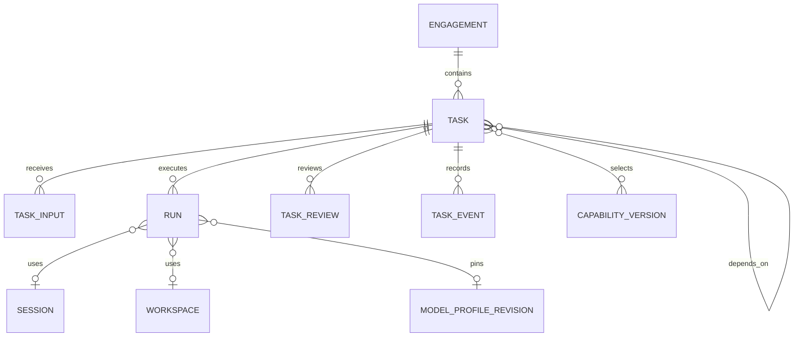

# OneFDE 首版数据模型与状态约束

2026 年 11 月 4 日协作推荐基线；C0+C1b持久控制已有验证，C2新增Worker认领/租约/停止确认/结果回填及固定SDK绑定，真实工程环境尚未验证，运维解锁仍未实现，见 [C2验证](../operations/c2-verification.md)。本文件是对象、版本和生命周期的权威来源；HTTP字段以 [OpenAPI](openapi.yaml) 为准。PostgreSQL是业务事实源，SDK Session、作业租约和页面消息均不替代业务状态。

## 身份与边界

Engagement 管客户交付目标；Task 管一项有范围、负责人和完成条件的持续工作；Run 管一次有界执行。本文与接口中的 Run 即讨论中的 AgentRun，不再另建同义对象。Session 是 SDK 上下文，Workspace 是代码/进程现场；多个 Run 可复用同任务的可信 Session 和代码，但不同 Run 有独立快照、时间与结果。

首个契约只支持 Engagement 内的工程任务。Business 线索先保留经营记录与交接引用，不为每条聊天建 Task，也不为内部经营研究虚构客户 Engagement。公司级长期任务可在实际需要时扩展 context 类型；Opportunity 独立模型和销售流程不进入首迁移。

## 知识服务、能力资产与业务来源

Knowledge 是支持 Business/FDE/Engineering 的执行角色，不是新的存储对象。Capability version 是经过整理的资产身份与不可变版本；业务资料则是经营记录、Engagement、原始证据和交付事实，保留原对象归属。知识答复只引用这些来源，不自动把原资料复制为 Capability 或更新客户确认状态。

后续知识工具需要记录实际角色/请求主体、调用ID、工作归属、问题、用途/受众、获准来源版本、答复和采用依据。已有 Task/Run 时关联原工作；Business 公司级短咨询可关联原请求/经营记录，不必伪造 Engagement。公司级长任务与非工程 Task 的 HTTP 创建入口仍属后续扩展，不改变当前首个工程契约。

来源/资产最小授权元数据包含归属对象、可见范围、可复用范围、允许用途/公开授权、事实/验证状态、版本及来源引用；这是后续逻辑约束，不表示首迁移已实现一套资料管理系统。派生答复/候选资产继续保留来源限制。具体访问与输出规则以[知识服务约定](../../capability-library/README.md)为唯一来源，运行日志记录检查结果及获准引用，不回显被拒资料的正文/标题/链接。

现有元数据/上下文快照和受控事件可承载首版咨询记录，不为每次读库建立 Task、新表或变更原 Task.spec_version。若建议影响已确认输入、工程范围或授权，仍走 TaskInput 与所有者采用；选用资产后固定版本并做实际检查。有效授权变化或跨项目/公开用途转换时重新过滤或重建 Session 上下文。

## 最低对象内容

| 对象 | 内容与责任 |
| --- | --- |
| Engagement | 客户/模拟身份、目标、证据、规则与方案版本、交付和反馈引用；FDE 维护业务语义 |
| Task | 稳定 ID、Engagement、原请求、spec、owner_role、executor_role、revision、spec_version、state、active_run_id、related_task_id、输入与评审记录；Task Service 校验写入 |
| TaskInput | task_id、单调 sequence、kind、正文/证据、reply_to_input_id、来源身份及 origin_run_id/action_id、pending/applied/rejected、处理依据和 applied_spec_version |
| Run | task_id、task_spec_version、attempt、状态/outcome、输入/权限/角色/模型修订快照、Session/Workspace、Git 基准及结果版本、产物/检查/副作用、时间和错误 |
| TaskReview | 固定 Task/spec_version、提交 Run、产物 ID、accept/request_changes、理由、检查证据、评审者与时间；不可改写历史 |
| TaskEvent | Task 内单调序号、event_id、类型、对象引用、操作者、时间；记录输入、派发、分配、评审和状态变化 |
| ModelProfile revision | 协议/地址/模型、secretRef、能力、参数/限额和适配修订；Run 固定修订，密钥值单独保存 |
| Capability version | 类型、条件、输入输出、实现版本、来源、验证和复用范围；资产状态见能力库约定 |

owner_role 是为工作目标、范围和评审负责的角色，executor_role 是执行角色。首个工程 Task 固定 fde/engineering；创始人可以代行所有者操作，但执行记录保留真实操作者。分配是逻辑概念，首版用 Task 字段、TaskEvent 历史和 Run 分配快照实现；不另建 Assignment 表或转派后台。模型不能仅凭请求体自称 FDE/创始人，来源身份由认证入口或受控运行工具注入。

## 持续工作与后续输入

同一次未关闭交付中的澄清、缺陷和范围内修改延续原 Task。新增独立目标、需要独立授权/验收的模块或已关闭后的后续工作，新建 related_task_id 指向原 Task，保留原交付证据。一个软件可有多个 Task，不能以一个 Task 包办其整个生命周期。

TaskInput 的 kind 为 clarification、change_request、question、answer。问题默认留原 Task 并指向负责人；只有答复本身成为需要独立跟踪的大工作时才建关联任务。回答必须引用同 Task 的 question；“数据缺失”可以被已确认的待核对规则解决，不要求 FDE 编造净重。

1. 收到输入先追加 pending 记录和 TaskEvent，递增 revision；运行中也可提交，不改正在执行的 spec/快照，不直接发送成 SDK 新指令。
2. FDE/创始人明确采用哪些输入、哪些拒绝及理由。拒绝保留记录；采用在没有活动或状态不明 Run 时，通过 apply-inputs 原子更新规格和输入处理状态，spec_version 与 revision 各递增一次。
3. 涉及规格的 clarification/change_request 采用时提交完整新 spec；answer 可沿用现有 spec，但其输入仍进入新版本快照。采用回答同时关联并解决对应 question，不允许其他无关问题被顺带标为已答。
4. 活动 Run 不隐式采用 pending 输入。MVP 先允许当前小段完成，或显式取消并确认停止；尚未采用的输入会阻止 start/continue/retry 和接受评审，避免带旧规则继续。没有实现任意工具调用中的动态热更新。
5. 业务澄清完成后，应用输入，再显式排队/继续。不自动因一条消息唤醒 Agent；原来的授权不因“补充资料”自动扩大。

## Task 生命周期

| 状态 | 含义与允许动作 |
| --- | --- |
| draft | 规格/范围尚在整理；可补输入、编辑、取消，准备充分后 queue |
| queued | 已准备，尚未建 Run；可能等待前置产物，满足条件后显式 start |
| running | 有 active_run_id，含环境准备、执行、取消待确认和尚未核实的结果整理 |
| waiting_input | 工程本轮已停止，存在待处理问题；可答复/采用输入，随后 continue 创建新 Run |
| review | 已有当前版本工程提交，等待业务接受；可 accept、request_changes 或提交新输入 |
| blocked | 执行失败、前置失效或现场不明；记录原因；确认现场后 retry/重新准备 |
| succeeded | 当前规格及固定产物已通过轻量评审；不等于 Engagement 已交付或生产发布已获准 |
| cancelled | 工作已取消，所有活动现场已确认停止 |

queue 仅记录就绪，不自动执行。start 在同一事务内建立 Run/作业并置 running。continue 从 waiting_input 创建新 Run，retry 从已核实停止的 blocked 创建新 Run，均保留原 Task。request_changes 保存评审及 pending 修改输入，Task 回 draft；处理后再排队。accept 只有在 review、无 pending 输入/未答问题、提交版本仍有效且检查证据满足时才置 succeeded。

cancel 取消整个工作；stop_for_update 只请求结束本轮以处理修改。后者先记 Run cancel_requested，确认停止后归 completed/superseded、Task 回 draft；不能误把 Task 关闭。采用输入但没有任何 apply_ids、只有拒绝时，仅更新处理记录与 revision，不增加 spec_version。

首版 succeeded/cancelled 关闭后不重开，也不追加改变范围的输入；后续 Task 通过 related_task_id 关联原任务和明确代码/产物版本。这是本项目简化历史和权限校验的选择，不宣称所有项目系统都如此。

## Run 生命周期与业务等待

| 状态 | 含义 |
| --- | --- |
| queued | Run 与作业已持久登记，尚未确认执行开始 |
| running | 当前代次正在执行 |
| cancel_requested | 停止意图已保存，尚待停止/副作用核查 |
| completed | 当前执行段已明确结束，必须有 outcome 和受控结果 |
| failed | 已确认停止的技术失败，有错误与证据 |
| cancelled | 已确认停止并核对已有动作 |
| interrupted | 无法确认现场是否仍在运行，保留占用直到核查 |

completed 的 outcome 仅为 submitted（提交工程成果）、needs_input（已停下并提交问题）、superseded（结果已不符合当前有效范围）。其他状态 outcome 为 null。SDK 返回 final message 不足以直接 completed，需校验实际执行结束及结构化结果。

| 已确认 Run 结果 | Task 变化 | 当前占用 |
| --- | --- | --- |
| completed/submitted 且固定版本有效、无未处理输入 | review | 清除匹配 active_run_id，保存产物和检查 |
| completed/submitted 但有 pending 输入 | draft，先处理输入；旧成果保留 | 同上 |
| completed/needs_input | waiting_input，关联具体问题 | 现场保存且无写入后释放 |
| completed/superseded | draft，重新准备 | 确认停止后释放 |
| failed | blocked | 确认停止后释放 |
| cancelled | cancelled | 确认停止后释放；非业务取消的中止另归 superseded/技术失败 |
| interrupted | blocked | 保留 active_run_id 和工程名额 |

业务等待结束本轮 Run，不保留一个占用 Worker 的 blocked Run。答复后新 Run 可以重新装配上下文并恢复可信 SDK Session，但不重写旧 Run，也不保证从某条模型指令位置精确续跑。SDK 内一次模型请求的有限暂态重试仍属于同一 Run。

结果、产物、Task 状态和占用释放在同一短事务登记，核对当前 Run 与版本。正常结束、人工核查和重复回报都通过同一领域服务；旧 Run 迟到结果只保留历史，不覆盖当前代次。外部部署不能因数据库回滚而自动撤销。

## 并发、授权与派发不变量

- revision 是并发行版本，任何任务相关写入都递增；用户命令携带 expected_revision。spec_version 是已采用规格/输入版本；状态、事件和 pending 输入不能悄悄改变它。Run 固定内容与 applied_input_ids 快照。
- active_run_id 对应 queued/running/cancel_requested/interrupted。runs.task_id 对这些状态建立部分唯一索引；每次认领校验当前 Run、规格、权限和依赖。Task waiting_input/review 没有活动 Run。
- 一个活动工程 Run 是全局执行配额，不是只按 Task 唯一。start/continue/retry 在共同事务级 advisory lock 下检查活动总量并登记 Run，提交后释放数据库锁；执行期间不持连接锁。
- Worker lease 是作业认领，不是旧写入者死亡证明。失租时冻结新派发、核查现场；若不能确认停止，保留 interrupted。先单 Worker，真正多执行者才引入能在写入端校验的 fencing；仅把 fencing 数字存数据库不能阻止旧 shell 写文件。
- 工具调用身份固定 origin_run_id/action_id，校验实际归属/允许角色，唯一约束去重；HTTP 幂等按身份/方法/路径/key 保存请求摘要和原响应，默认24小时。先重放后检查 revision，同键异请求409；过期后仍受活动 Run 与工具动作唯一约束。
- 依赖必须同项目、无自依赖/环，前置 Task 已接受且引用的 spec_version、产物版本仍有效。源文件/代码变化可能影响下游时标记待重算，不把旧结果当当前成功。C 尚未实现依赖时明确拒绝非空依赖。
- 商业范围/发布权限由创始人决定；FDE/Engineering 都只能在受控操作中提出或执行已授权工作。轻量 TaskReview 不等于生产发布授权，发布授权固定目标环境与构建版本，不默认跨版本复用。

## 事务、事件与上下文

Task Service 维护目标、输入、分配、评审和业务状态；Dispatcher 核对可执行条件、登记 Run/作业、处理执行占用；Runtime 装配上下文、调用 SDK、运行工具并提交事实。事件记录是 Backend 内模块，不是独立消息微服务。Task/输入/评审变更与 TaskEvent 同事务；需要执行时同时建立 dispatch_jobs。

Worker 直接消费 PostgreSQL 作业，运行细节放 run_events。任务级通知从 task_events/未处理输入读取；客户端断线后可按 sequence 补读。没有 Redis 外部双写，不另加 relay；将来引入消息代理时再用事务 Outbox 与幂等消费，不承诺恰好一次或全量 Event Sourcing。SDK 工具执行、租约检测属于已接单工作处理，不扩展为主动事件监听。

每个 Run 装配目标/范围、确认规则、已采用输入、相关证据、前置已接受产物、能力版本、Git 基准与当前修改、必要历史摘要、工具权限和限额。未采用输入只可作为“待处理提醒”，不能被模型当新授权。不同 Agent 的工具/Session 与上下文按任务隔离；不把全部 Engagement 聊天发送给每次执行。

## 最小物理映射与建设顺序

| 表 | 最低内容/约束 | 阶段 |
| --- | --- | --- |
| engagements | UUID、title、is_demo、goal、context JSONB、时间 | C |
| tasks | 项目/原请求/task_key、owner_role/executor_role、spec JSONB、revision/spec_version、state、active_run_id、related_task_id；项目内 request_id/task_key 唯一 | C |
| task_versions | Task/spec_version唯一；不可变spec、已采用输入ID、操作者/理由；C1a草稿回填版本1 | C1b |
| task_inputs | 目标、sequence、kind、正文/引用、来源/回复、处理状态、applied_spec_version；task_id/sequence、受控工具 origin_run_id/action_id 唯一 | C |
| task_reviews | Task/spec/Run/产物、结论、理由、检查证据、操作者；不可变记录 | C |
| task_events | Task/sequence、event_id、类型及对象引用；Task/sequence、event_id 唯一 | C |
| runs | Task/spec、attempt、state/outcome、快照、角色/模型修订、Session/Workspace/Git 引用、结果和时间；Task/attempt 唯一、活动部分索引 | C |
| dispatch_jobs | operation_id、run_id、kind、payload、state、claim_owner、lease_until、attempts/next_attempt_at；operation_id 唯一 | C |
| run_events | run_id/sequence、event_id、类型、摘要和时间；Run/sequence、event_id 唯一 | C |
| artifacts | engagement_id、run_id可空、kind、服务端object_key、SHA256、大小/保留状态、代码/构建版本 | C |
| model_profiles/revisions | 不可变模型与适配配置、secretRef、限额；部署配置供给后入库，不做首版编辑后台 | C |
| auth_sessions / idempotency_records | token摘要/CSRF/过期；HTTP幂等请求摘要与响应；工具按origin_run_id/action_id唯一并保存结果引用至Run归档，不套用HTTP的24小时短保留；密钥不在正文 | C |
| task_dependencies | Task、前置Task/spec/已接受产物；复合唯一 | D |
| capabilities/versions | 元数据、来源、实现/验证/复用范围；可先从既有目录导入 | E |

PostgreSQL 17 + SQLAlchemy/Alembic 管理；JSONB 保存演进中的规格与快照，不代替状态、主键、唯一性或外键。跨项目引用/环等由领域服务同事务校验，不能依赖查询其他行的普通 CHECK。Assignment、通用 Decision、Opportunity 先不建独立子系统。

文件与长日志放私有 S3 兼容存储，数据库保存受控引用；代码用 Git 记录基准/提交及未提交变更快照。不同 Task 默认独立分支/工作区，集成 Task 明确采用的提交；全局串行也不意味着所有项目共用可写目录。SDK 持久路径显式配置，Session ID 本身不等于历史已落盘；Session 不可信时从业务事实与代码重建，而非盲目重放副作用。

能力检索先元数据和关键词；客户报价数据模型归[具体项目](../../engagements/demo-supplier-quotes/brief.md)。架构分责见[架构](architecture.md)，用户操作见[交互](../design/design.md)，配置/保留见[部署](../operations/deployment.md)，检查见[测试](../operations/testing.md)。

## C1b 已实现物理子集

版本历史新增task_versions；模型修订以单表model_profile_revisions保存不可变元数据，未建设配置编辑后台。C1b时dispatch_jobs仅有operation_id/run/kind/payload/state，artifacts仅保存元数据；之后的C2扩展见下节。TaskInput增加处理人/理由/时间与明确解决的问题引用。Task/输入/版本/事件及Run/作业状态同事务更新，HTTP幂等在版本判断前重放。

已停止与现场不明的区别按上述契约实现：未认领queued作业可在事务锁下撤销；running只记录停止意图，确认停止后释放；interrupted保留占用且本轮未开放运维强制恢复。模型修订、版本、评审、事件、产物元数据和已登记Run事实有数据库历史保护。具体检查和未接能力见 [C1b记录](../operations/c1b-verification.md)。

## C2 已实现物理扩展

迁移d5454eda0523只扩展dispatch_jobs：claim_owner/claim_token/lease_until、claimed_at/completed_at/attempts、runtime_ref、result_digest/result_payload及轮询索引。token不是写入工程文件的fencing，过期不允许自动换代重执行；现场不明保持interrupted占用。已回填作业同owner/token/结果摘要可重放，不同结果冲突；停止意图在回填事务内重新核对，保留已持久产物后归一为cancelled/superseded。

模型配置由受信任CLI供给，只存端点/secret_ref/限额，未真实验证时保持configured。Worker在私有本地不可变blob中保存源码/结果回执并检查SHA-256/大小，再同事务登记元数据；停止证据和终端退出码在作业结果中保存，状态摘要仍走原有事件。每Task保留工作区，每Run新SDK Conversation与独立Session目录；不自动复用Session/解锁interrupted。S3、下载签名和跨节点产物服务仍未实现。操作与检查见 [Worker手册](../../backend/WORKER.md) 和 [C2验证](../operations/c2-verification.md)。
