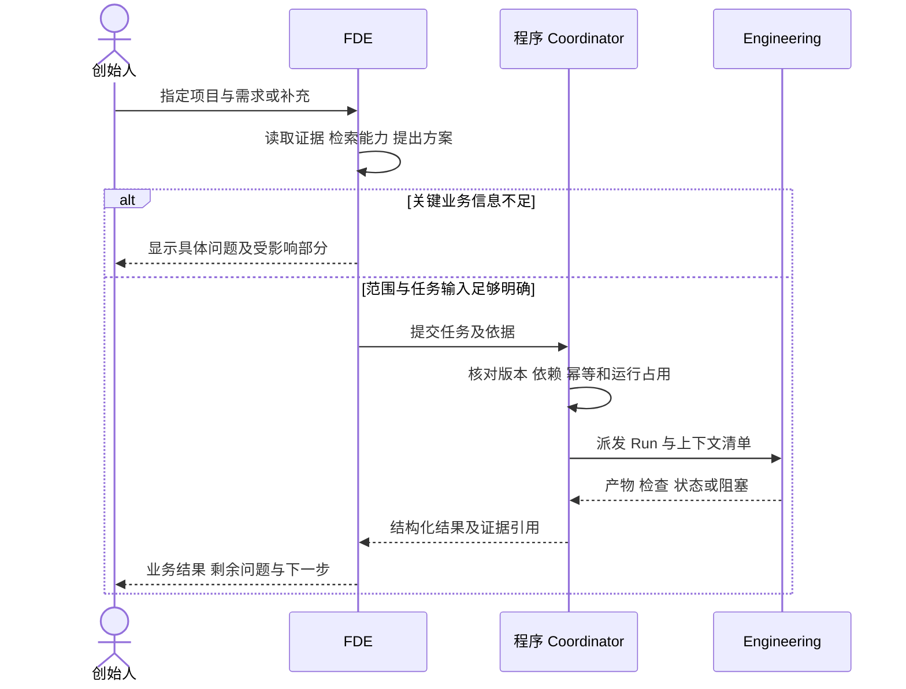
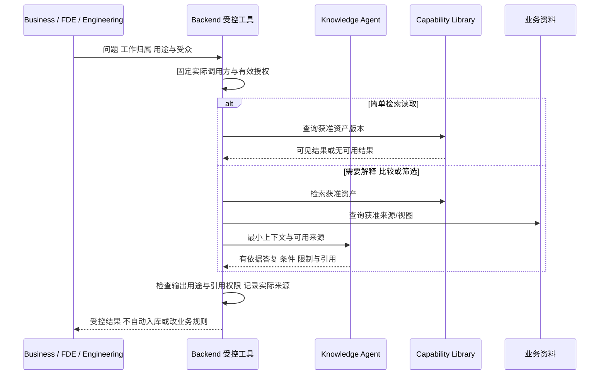

# OneFDE 首版关键交互设计

本稿用于把 [PRD](../product/PRD.md) 转成可实施的用户操作与反馈。2026 年 11 月 4 日按已确认[黑客松实施方案](../product/hackathon-proposal.md)收窄首版界面范围。**FDE 受控工具与交付详情 API 已实现**（`POST /api/v1/engagements/{id}/fde/tools`、`GET .../delivery`）；三入口薄页面尚未实现。重点是首个交付流程；前端推荐 React/TypeScript/Vite 与 Ant Design，技术依据见架构。**先后端受控工具，再接薄页面**；完整 CRM/IDE/四套工作台后置。

## 入口与信息组织

黑客松工作台只做三个最薄入口。完整经营/工程独立产品面不在本切片范围；工程操作嵌在项目详情中。

| 入口 | 比赛版本需要完成的操作 | 首先显示的信息 |
| --- | --- | --- |
| 项目列表（含业务交接） | 查看 Engagement；从列表发起模拟 Business→FDE 交接 | 项目名、模拟标记、当前阻塞/下一步 |
| 项目交付详情 | 澄清、方案、Task/Run、检查、版本、采用/修改/接受 | 见下节最小结构 |
| 能力条目 | 检索少量获准条目，核对来源/版本/条件/权限 | 解决的问题、验证状态、复用范围、来源 |

选定 Engagement 后输入的请求沿用该项目身份，由程序记录归属；切换项目时显示明确项目名称。经营交接不强行扩大为完整 CRM；工程操作也不依赖模型从自然语言猜用户已选择的项目。

## 项目详情的最小结构

项目交付详情一页展示（同页区域即可，不以分区名倒推页面数量）：

| 区域 | 必须可见 |
| --- | --- |
| 来源与未知项 | 模拟/真实标记、资料引用、待澄清问题 |
| 方案与规则 | 已确认/建议/待确认及来源；R01—R05 适用范围 |
| Task 与 Run | 当前 Task、业务状态、最近 Run 摘要（非完整容器日志） |
| 检查与版本 | 自动检查结果入口、固定源码/产物版本 |
| 关键操作 | 保存输入、采用输入、要求修改、接受提交；发布另授权 |

规则显示已确认、建议或待确认及其来源；模拟资料在项目标题和相关输入附近有文字标记。项目概览展示阻塞原因及需要创始人决定的事项；原始 CoT 与完整容器日志默认折叠，按需展开。

## 从请求到工程结果

用户查看任务目标、输入、前置依赖和完成条件后，可以启动已准备的任务。首版保留人工触发，不建设复杂审批；是否直接自动启动属于后续可配置行为，不在界面上隐含授权。

## 请求归属与变更

| 情况 | 应呈现的行为 |
| --- | --- |
| 新交付需求 | FDE 明确范围，形成新任务或多个有关联任务，保留原请求 |
| 补充原任务资料 | 选定原 Task 保存输入，显示“已记录，尚未采用”；不直接修改运行中快照 |
| 语义相近但目标不同 | 保留独立需求，不因为名称相似自动合并 |
| 工程发现范围外需求 | 显示发现及影响，回 FDE 判断是否更新方案，不静默扩大任务 |
| 运行中修改关键规则 | 显示当前 Run 的旧版本与待处理输入；可等当前段结束，或“停止本轮以处理修改”，不把该操作当取消整个 Task |
| 已关闭后的维护/独立新目标 | 新建关联 Task，带明确原代码/产物版本，不篡改原完成记录 |

## 任务和运行反馈

任务与运行的权威状态定义在[数据模型](../architecture/data-model.md)。界面展示任务的业务状态，同时可以展开其多次运行，不把 Session 空闲或连接断开当作任务完成。

| 情况 | 用户看到什么 | 可以做什么 |
| --- | --- | --- |
| 输入未完整 | 草稿及缺失项 | 补资料或询问 FDE |
| 等待前置任务或执行资源 | 已排队及具体等待原因 | 查看前置任务，或取消尚未启动工作 |
| 正在执行 | 当前阶段、最近可核实活动及运行开始时间 | 查看日志与产物，提交补充，取消 |
| 需要业务输入 | 待答问题、本轮已停止、原代码/结果仍保留 | FDE/创始人回复原问题，采用后在同 Task 开始新 Run |
| 工程已提交 | 待业务检查、固定提交版本、产物与检查证据 | 接受，或说明需要修改的内容；接受不自动发布 |
| 执行失败 | 失败步骤、已知原因、保留产物和恢复入口 | 查看证据，重试符合条件的任务 |
| 正在取消 | 取消请求已记录，执行仍待停止确认 | 查看停止结果；不显示为已取消完成 |
| 执行状态不确定 | 中断或失联说明，历史结果仍可见 | 核对现场并恢复；不自动启动第二个写入同工作区的运行 |
| 任务完成 | 已接受的规格/产物、评审者、检查和限制 | 查看成果、后续集成/发布；新范围建关联任务 |

不使用无依据的完成百分比。可以展示“准备环境、执行、构建检查、结果整理”等实际阶段。重试按钮明确它重试哪个任务版本；重复点击返回同次操作结果。运行活跃时阻止另一次启动并解释原因。

取消不保证撤销已经发生的部署或文件写入。终止结果显示已完成的动作、已停止部分和需要核查的外部状态。页面刷新或断线后从持久记录恢复任务概况，而不是仅依赖实时消息。

任务详情增加“输入与问题、运行、工程提交与评审”区域，展示 owner/executor 和每次输入的 pending/applied/rejected 状态。关键内容只有采用后才进入新规格；回复问题显示引用关系，不能让一条回答自动关闭所有问题。采用/拒绝可批量确认，按钮操作对应同一个领域命令，界面不要求用户填写 spec_version 等内部字段。

“接受提交”绑定当前 Run、规格与产物；存在待处理输入或旧版本时解释原因并阻止接受。“要求修改”保留提交/评审历史，将修改意见放回同 Task。运行详情把 completed/submitted 显示为“本轮已提交”，completed/needs_input 显示为“本轮结束，待补资料”，避免以统一绿色“成功”混淆业务结果。

## 模型与运行环境设置

在运行前选择已配置的 ModelProfile：显示服务商、模型、协议、实际接入状态和当前运行限额。模型配置与项目业务规则分离；首次未配置时显示部署配置说明，首个切片不做密钥管理后台，不把它描述成业务需求错误。

密钥通过服务端 secretRef 使用，不回显到聊天、任务正文或普通日志。仅填配置时显示“已配置”，短工具任务实际通过后显示“当前配置接入已检查”；不把一次冒烟写成模型质量认证。Run 固定配置版本，改变设置不静默替换运行中模型。

## 首个工程切片的实现约束

实现顺序：**FDE/业务受控工具与后端契约 → 三入口薄页面**。不因设计稿提前初始化完整前端依赖。比赛版先登录、项目列表（含交接）、项目交付详情、少量能力条目；Ant Design 提供表单、表格、状态和时间线；React Router 管理路由，TanStack Query 管理查询。活动页面约 2 秒读取任务/运行，页面隐藏或终态停止；查询缓存按 Engagement/Task/Run ID 区分。写操作不自动重试，重复提交保留原幂等键；409 刷新当前版本并解释冲突，不能静默覆盖输入。

关键按钮与后端命令一一对应：保存输入（pending）、采用输入（进入新规格）、要求修改（同 Task 续作）、接受提交（关闭 Task，不自动发布）。界面不要求用户填写 `spec_version` 等内部字段。首版将“准备排队”和“开始执行”分开：queue 只确认就绪，start 创建 Run；等待前置时展示原因。continue 和 retry 均创建新 Run，可以复用可信 SDK Session；活动或现场不明时拒绝并行写入。输入、采用、评审和任务事件契约见 [OpenAPI](../architecture/openapi.yaml)，四角色完整对话接口随实际切片扩展。

## 交付与能力复用

部署结果展示具体软件版本、可访问入口、访问验证时间及有效期或限制。OneFDE 内部工作台与**客户报价工具使用独立产品 Origin**（或受限预览）；生成的 HTML/JS **不得**在工作台认证 Origin 内直接执行。工作台只展示可信元数据与访问入口。客户不用进入内部工作台。

Business、FDE、Engineering 都可在自己的工作上下文检索获准资料/资产，或请求 Knowledge 分析。Business 查询案例/服务能力与材料依据，FDE 查询业务知识/方案适用性，Engineering 查询模块/接口/依赖与工程经验；不要求每次查询先转 FDE。

界面与后端结果区分“Knowledge 咨询答复”“Capability 条目/固定版本”“业务来源记录”，展示获准来源、事实/验证状态、适用限制与可用用途。答复不是自动入库；候选入库是另一个受控动作。业务原文链接留在原经营记录/Engagement，当前身份无权访问时不显示受限标题或可绕过的下载链接。

公开材料场景单独标明“内部可参考、可跨项目复用、可对外展示”，不能仅用一个已验证标记代替三种权限。Business 使用有授权的案例版本/视图，模拟成果明确标注；未获公开授权的素材返回可执行的缺口说明，而非自动生成一份看似可公开的摘要。

Knowledge 无结果或依据不足时说明未知；Engineering 采用建议仍须实际集成/检查，业务规则或范围变化回原 Task。三者反馈可提交来源明确的候选整理请求，保留采用/拒绝原因。详细服务和资料权限以[能力库约定](../../capability-library/README.md)为准。

图中展示的是有界查询示例，尚未实现。Business 可只有公司经营请求ID；涉及工程时带当前Task/Run。权限校验由 Backend 工具完成，不由提示词或 Knowledge 自行决定。

## 交互检查

关键操作、状态和错误原因提供完整文字，颜色仅作辅助。操作完成、失败和取消均有明确反馈；表单错误保留输入并指出需修正位置。键盘可到达主要控件，错误和状态更新不只通过动画传达。宽表格保留列标题与详情入口，关键问题不能只显示省略号。

本稿对应 P02—P10 与 V02—V10。阶段 C 优先实现任务与运行查看、真实执行反馈和错误恢复，其他区域按闭环需要补齐。
