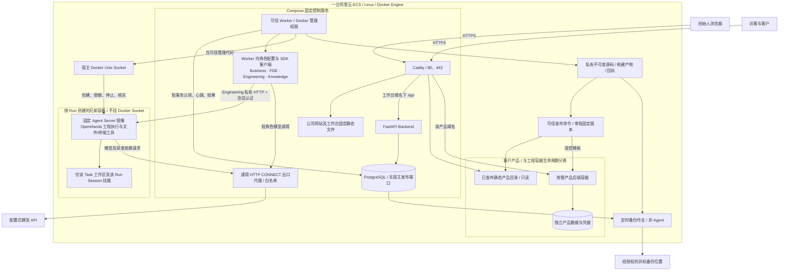

# OneFDE 单台 ECS 部署设计

状态：2026年11月4日，用户明确将黑客松及MVP部署基线调整为**单台阿里云ECS + Docker Compose，一体化部署整个OneFDE及客户产品**。用户随后授权先实施本地S1/S2；现已增加本地单机Compose与ecs_shared适配，实际边界/结果见[单机验收](single-ecs-verification.md)，操作见[Compose手册](../../deploy/README.md)。没有购买云资源、调用模型或公网部署。以下完整拓扑仍含待实施能力。新决策见[ADR0009](../architecture/ADR/0009-single-ecs-mvp.md)，取代ADR0003/0008要求工程执行另机的MVP假设。

本文件是物理拓扑、服务边界、发布、持久化和资源预算的权威来源。[架构](../architecture/architecture.md)维护逻辑协作，[数据模型](../architecture/data-model.md)维护Task/Run语义；阶段与可检查完成标准见[单ECS实施与验收](single-ecs-verification.md)。设计数值均为起步预算，不是负载实测或可用性承诺。

## 单机完整架构

同机共享CPU、内存、磁盘及内核，**隔离单位是服务身份、容器、挂载、网络和配额，不是四个角色分别占一台机器**。本地WSL的单机事实说明部署机制可复用，但不代替公网安全、在线模型、恢复或负载验收。Compose本身支持单服务器部署；不增加Kubernetes、Redis、独立调度集群或第二台ECS作为前置条件。[Docker官方生产Compose说明](https://docs.docker.com/compose/how-tos/production/)

## Compose 服务划分

本地已实现`deploy/compose.yaml`、项目`onefde-local`：API/PG/Worker与离线代理独立容器。生产项目拟为`onefde`；现有配置依赖WSL路径/构建缓存，未含Caddy/网站/工作台/产品、在线模型出口及异机备份，不能直接作为生产配置。`backend/compose.yaml`仍仅为旧本地开发PostgreSQL。

| 服务/组件 | 部署方式与常驻情况 | 网络、挂载及权限 |
| --- | --- | --- |
| `gateway` | 1个Caddy容器，常驻；直接服务公司网站、工作台及静态产品，不再为静态页面增加Node进程 | 仅它发布80/443；挂载Caddy配置及已发布目录只读、证书卷可写；无Docker Socket/DB密码 |
| `api` | 1个应用容器、先1个Uvicorn进程；安装核心依赖 | 接入边缘网和控制网，内部8000；无Socket/工程工作区；受限应用DB身份 |
| `postgres` | 1个固定PostgreSQL17容器，常驻；不必一开始使用RDS | 静态首例仅控制网，无`ports`；独立数据卷、迁移/应用/Worker/备份身份分离 |
| `worker` | 1个可信应用容器、1个消费进程，安装worker extra及Docker CLI | 控制网、工程私网；挂载Socket、私有Worker数据及模型secret；不发布端口、不运行模型可任意调用的宿主shell；非root用户需匹配宿主Socket GID，不能用privileged解决权限问题 |
| 四角色Runtime | Worker内部模块/SDK会话及受控工具，不是4个常驻服务 | Business/FDE/Knowledge无终端，Engineering的终端只在Sandbox；每次请求装配授权上下文 |
| OpenHands Agent Server / Sandbox | 每个活动工程Run按需创建1个容器；SDK客户端在Worker，远端执行与工具在此容器；不是Docker-in-Docker | 仅工程私网；不加入控制网/产品网、不挂Socket；只挂当前Task/Run目录 |
| `egress` | 1个小型成熟HTTP CONNECT代理容器，如Squid；有模型/依赖联网时常驻 | 工程私网与出网侧网络双接入，限定目的地；不是LLM Router，不做模型选择 |
| `migrate`、`backup`、`publish` | 同镜像CLI/Compose profile短作业或宿主受控命令，非额外常驻Agent | 权限按命令拆分；发布命令不暴露给工程shell；备份读取权单独提供 |
| 客户产品后端 | 只有产品确实需要后端时，建立`product-<id>`独立Compose项目/容器；静态产品无此服务 | 每产品独立网络与数据，Caddy只接其入口；产品进程无平台DB身份/Socket |

这里的OpenHands Runtime指仓库已选的SDK/DockerWorkspace/Agent Server组合：客户端由Worker装配，工程循环和工具在动态Agent Server中运行；不额外部署另一套OpenHands Web平台或旧版Runtime服务。

静态构建文件是部署产物，不是常驻服务。产品可先使用同一PostgreSQL进程中的独立数据库/角色，但禁止平台与产品表混用、禁止跨库权限；客户风险要求更高时才选独立PG容器。若共享PG进程，只让PG额外加入该产品的专用data网络，后端加入该data网与自己的入口网；不让产品加入control网，API/Worker也不加入产品网。用pg_hba、CONNECT/schema权限及独立密码拒绝平台库和其他产品库，不能只创建不同库名就认为已隔离。当前首个浏览器报价工具不需要产品后端或产品DB。

Compose实现时明确`cpus`、`mem_limit`、`memswap_limit`、`pids_limit`、`healthcheck`、`restart`和日志轮转；`depends_on: condition: service_healthy`只是首次启动条件，不替代应用重连。核心服务重启策略与动态Sandbox分开；Sandbox退出不自动重跑，数据库健康后再处理作业。[Compose服务参数](https://docs.docker.com/reference/compose-file/services/)

## Agent 按需调度与 Run

当前已实现的是Engineering工程Task和串行Worker；其他角色工具、公司级长任务入口及通用角色执行适配是**待实施能力**，不能把图当成四角色已经接通。

- API校验身份、范围、revision/规格和额度，在同一事务保存Run与`dispatch_jobs`，返回202；模型调用不放API请求线程。
- 一个Worker依据任务指定角色选择配置/工具，不增加路由模型。角色配置对象可常驻，模型会话按请求创建/结束；不需要4个持续轮询的Agent进程。
- Engineering沿用现有持久Task/Run、owner/token租约、全局活动槽。初期工程并发为1，`interrupted`继续占槽，禁止因超时自动再起一个写入者。
- 短检索直接走受控工具；短角色分析在Worker执行上下文内有界调用，关联请求/父Run、权限与总预算。公司级短咨询不伪造Engagement或工程Task；长期角色工作到对应阶段扩展受控协议。
- 起步整个Worker同一时刻处理1个顶层Agent工作；工程内部最多顺序调用1层专业咨询，深度上限2（主调用+一次咨询），共享总费用/时间，禁止互相递归。工程运行时其他顶层请求排队，API读写继续可用；避免单Worker同步等候另一个由自己认领的作业造成死锁。
- Business/FDE/Knowledge的成熟SDK循环可在Worker内运行，但工具只允许经过校验的业务读写，不给`eval`、任意Python执行或shell工具。Engineering的RemoteConversation在Agent Server里跑工具，不把返回代码直接在Worker执行。

## Worker → Agent → Sandbox 完整链路

1. Worker以短事务认领并固定Task/spec/model修订/已采用输入，提交后再执行；心跳使用独立Session，SDK调用期间不持业务事务。
2. 通过可信路径映射创建`tasks/<task_id>/workspace`、`sessions/<run_id>`及独立私有Session密钥；固定镜像摘要，核对限额与可用磁盘。执行配置由程序产生，模型不能提交任意镜像、挂载、网络或Docker参数。
3. Worker调用宿主Docker创建**兄弟容器**，不是在Worker里嵌套daemon。创建时设置资源、安全选项与工程私网；登记容器ID、Run标签和Session引用，再健康检查。失败必须停止并核实或保留interrupted。
4. Worker通过工程私网的容器地址访问Agent Server，使用每Run认证密钥。现有SDK发布宿主127.0.0.1端口的做法不能被bridge Worker当作自己的localhost；`ecs_shared`已补私有地址接线，无宿主发布Agent端口、无host网络，正确/错误认证已实测。
5. SDK装配Engineering工具白名单与模型配置，发送冻结规格；终端在Sandbox内编辑、安装获准依赖、运行检查和构建。只捕获真实命令/退出码/产物；模型final只作结果提案。
6. 结束或收到停止意图后，先停止容器并以成功清单/inspect核实，再打包源码及构建结果、计算摘要并保存私有回执；短事务原子回填Run、Task、产物和事件。同代次幂等，迟到结果不可覆盖。
7. 提交进入review，所有者接受固定版本后才完成Task；发布另核对授权。待业务回答时保存问题和现场并结束本轮，采用回答后原Task新Run续作；不保持一个Agent进程长期等待。

容器内的bind源路径由**宿主daemon**解释。建议宿主与Worker都使用相同绝对路径`/srv/onefde/worker`，即该路径同名bind进Worker；再由Worker只把具体Task/Run子目录挂进Sandbox。不把容器内任意`/app/work`误当宿主路径，也不把整个Worker根目录交给Sandbox。[Docker bind mount边界](https://docs.docker.com/engine/storage/bind-mounts/)

固定SDK1.59.0的DockerWorkspace复用为基础，不重写Agent loop。共享模式窄覆写`_start_container`，创建时设置权限/限额并在启动前登记ID，沿用SDK健康/工具接口；旧模式保留原接线。私有方法耦合须随升级复核，后创建`docker update`不足以保护启动阶段。[固定上游源码](https://github.com/OpenHands/software-agent-sdk/blob/ccae18cb897bef7960f210aa3f380b577a84be7c/openhands-workspace/openhands/workspace/docker/workspace.py)、[官方Sandbox说明](https://docs.openhands.dev/sdk/guides/agent-server/docker-sandbox)

## 安全边界与网络

### 可信 Worker 与不可信执行代码

Worker持有Docker Socket等价于拥有宿主高权限，容器化不能消除它。只有经审阅的平台代码运行在Worker；不能向模型开放任意Docker命令、任意挂载或Worker内终端。Socket挂载`:ro`也不等于Docker API只读。API、Caddy、普通角色工具及客户产品均无Socket。MVP可接受这一可信管理边界，但不能宣称抵抗Worker被攻陷或内核逃逸；需要承载敌对租户时再增强执行隔离或拆机。[Docker daemon权限说明](https://docs.docker.com/engine/security/)

| Sandbox约束 | 设计要求与实际核验 |
| --- | --- |
| 身份与权限 | 固定非root UID/GID；当前镜像用户UID10001，需核对sudo/setuid路径；`cap_drop: ALL`、`no-new-privileges`、默认seccomp/AppArmor；无privileged/host PID/host network/设备直通 |
| 文件 | 仅当前Task workspace和当前Run Session可写；不挂平台源码、PG、产品发布目录、secret根、Socket或宿主根目录；拒绝路径穿越/符号链接；目录700、secret600。MVP保留现有10001挂载映射；多租户不同UID隔离待需求出现时扩展 |
| 根文件系统 | 目标read-only根，缓存/tmp/home所需写入点使用有界tmpfs或专用目录；先验证Agent Server兼容，不把简单添加read_only后无法启动当作完成；过渡期可写root需独立限额 |
| 资源 | 在create/run阶段即设置CPU/内存/swap/PID/ulimit；设置执行截止和启动截止；工程子进程/构建不能只依赖Worker容器自身的cgroup限额 |
| 网络 | 只有工程私网；无宿主ports、无Docker API、无控制库/产品网；仅经白名单出口代理联网，实际测试直连和DNS/IP绕过 |
| 凭据 | 不注入平台DB、云账号、发布或备份凭据；单Run会话key与受限模型key分开。RemoteConversation模型配置可能存在同一工程容器内，MVP不承诺模型key与任意shell彻底隔离；模型限额及密钥撤销需另核对 |

同机普通容器不等于VM强隔离；服务、挂载和网络边界在同一宿主落实即可，不因这一事实默认要求第二台ECS。

### 网络与端口矩阵

| 网络 | 允许成员与连接 | 默认拒绝 |
| --- | --- | --- |
| `edge` | Caddy→API:8000；Caddy→对应产品入口；Caddy取证书/更新 | 外网直连API/PG/Worker/Agent Server；Caddy读取控制DB |
| `control`（internal） | API与Worker→PG:5432；迁移/备份短作业按身份进入 | Sandbox、公司页面及客户产品连接平台PG |
| `sandbox`（internal） | Worker→指定Agent Server:8000及响应；Sandbox→egress代理指定端口 | Sandbox→Worker新连接、其他Sandbox、宿主服务及控制/产品网络 |
| `product-<id>` | Caddy→该产品后端；后端经独立data网→自身DB/卷 | 产品间和产品→内部平台横向访问；后端无须共享平台secret |
| `egress-out` | 只有出口代理连接批准的公网HTTPS目标 | 代理转发私网、环回、宿主、其他容器和云元数据 |

internal网络和代理环境变量本身不足以保证全部限制。工程桥的FORWARD/同桥流量使用经过验证的DOCKER-USER策略（本设计按iptables后端），宿主目标另用INPUT；允许Worker发起流量的回复后拒绝Sandbox新连接，确认br_netfilter/IPv6行为。若Docker采用其他防火墙后端，应按对应机制重新核验，不混用失效规则。[Docker防火墙说明](https://docs.docker.com/engine/network/firewall-iptables/)

代理只允许明确的模型域名和批准的依赖源，CONNECT限定443；解析后再次拒绝私网/IP字面量和重绑定结果。Sandbox不得通过第二张网卡、宿主网关、任意DNS或host.docker.internal绕过；禁用IPv6或提供等价规则。尤其拒绝阿里云元数据`100.100.100.200`及链路本地段，不依赖安全组默认设置；模型联网和镜像daemon拉取是不同出站路径，分开审计。白名单不能保证允许目的地收不到容器已可见的内容，因此资料范围/密钥最小化仍独立生效。[ECS元数据说明](https://www.alibabacloud.com/help/en/ecs/user-guide/view-instance-metadata/)

公网安全组只开放80/443；SSH限定管理员来源，Caddy管理接口、Docker TCP、PG及Agent Server均不公开。动态容器不加入默认bridge或所有服务共用的默认网络。动态IP/重建后规则由可信配置更新，并测试重启后仍有效。

## 客户产品构建、部署与访问

Engineering在Sandbox内执行检查与`npm build`等构建，保存源码、锁文件、dist及实际结果。它提交**待发布产物**，不能把工程容器改名后直接变成客户服务。

1. Worker保存不可变产物及摘要；源码与dist分开，排除node_modules/.venv等可重建缓存，不把secret或Session发布。归档大小/文件数和路径重新校验；当前全工作区归档实现尚需补产品manifest/过滤。
2. 所有者评审并固定Task/spec/Run/Artifact版本，再明确目标产品、域名、发布版本和权限。发布幂等依据产品+产物摘要+目标环境；HTTP没有发布API的当前事实保持。
3. 可信发布CLI/Worker受控发布分支校验白名单产品和文件类型，在私有staging区检查后写入`/srv/onefde/releases/<product>/<digest>`。静态产品验证后原子切换受控current入口，保留上一版；Caddy只读发布根，Sandbox根不与发布根共享可写目录。
4. 需要后端时，MVP优先采用受信任固定运行镜像+只读版本代码、独立产品卷/网络与secret，通过该产品Compose项目启动并健康检查，再切换代理。产品数据库用独立角色。模型不能提供任意宿主Compose文件或给自身Socket；需要自定义镜像时再增加同机有界构建作业和受控模板，不让Agent执行Docker-in-Docker或无界宿主Dockerfile构建。
5. 从客户网络做实际访问、核心功能、跨产品拒绝和回退检查；记录部署摘要/时间/入口/期限。静态版回退切current，服务回退镜像/配置；数据库有破坏性迁移时必须另备份/前向修复，不能只退代码。

首个报价工具仍推荐浏览器内处理Excel/CSV的静态应用；不强制增加后端或上传业务文件。公司网站、工作台和客户产品可分别更新，OneFDE/Sandbox停止不影响已发布静态产品（整个ECS故障仍共同受影响）。

| 域名示例（未注册） | Caddy目标与访问边界 |
| --- | --- |
| `www.<domain>` | 公司网站只读目录 |
| `app.<domain>` | 工作台SPA；同源`/api/*`代理API；创始人登录、Secure/HttpOnly/host-only Cookie、CSRF、精确信任Origin |
| `quotes.<domain>` / `<product>.<domain>` | 该产品静态目录或后端；客户不因此获得内部OneFDE身份 |

默认不同子域名隔离浏览器Origin和Cookie；如必须路径共站，另审查路由/base URL、CSP、Cookie及脚本共享风险。Caddy用显式站点表，不根据未审阅Docker标签自动公开新服务。首次使用明确域名证书，不默认通配符DNS凭据；证书数据卷持久化，DNS解析/80、443可达与CA限额在实施时核验。[Caddy HTTPS](https://caddyserver.com/docs/automatic-https)

前端不放密钥。工作台仍为单创始人认证；Caddy TLS不代替应用授权。对客户上传、后台数据和可公开内容沿用PRD及Engagement授权边界。

## 持久化、密钥与备份

| 数据 | 同ECS保存位置（拟定） | 恢复与访问原则 |
| --- | --- | --- |
| PostgreSQL | 命名卷或专用数据目录，仅PG挂载 | Task/Run/版本/事件权威事实；迁移前备份，PG重建不删卷 |
| Task源码 | `/srv/onefde/worker/tasks/<task>/workspace` | Task独占写，按Run记录固定快照；容器删除不删工作区 |
| SDK Session | `.../sessions/<run>`；密钥`.../private/<run>`分离 | Session可能敏感，非公开Artifact；默认每Run新会话，不声称已支持自动恢复旧Conversation |
| 源码/构建/日志/回执 | `.../artifacts`不可变blob，DB记摘要与归属 | 当前私有本地实现可复用；MVP不新增MinIO/S3服务作为必备组件 |
| 产品版本/数据 | `/srv/onefde/releases`及各产品数据卷 | 正式版本与可写工程目录分开；保留上个可用版本 |
| 证书/配置/secret | Caddy数据卷；宿主受限配置，按服务挂载 | secret不提交Git、不给Sandbox/公开站点；备份密钥独立保管 |

Docker卷跨容器重建保留数据，但不是异机备份。[卷生命周期](https://docs.docker.com/engine/storage/volumes/)

每日演示备份建议保留7日、迁移/正式发布前额外备份；PG使用与17兼容的`pg_dump`/`pg_restore`及角色信息导出，不直接tar运行中的PGDATA。备份清单关联数据库快照、已提交不可变产物/版本与单独加密secret；暂停新派发并确认写入停止后备份需恢复的工作区，缓存不备份。异机副本可先用现有受控电脑或经后续授权的对象存储；不因此默认增加第二台ECS或本轮开通OSS。[PG17逻辑备份](https://www.postgresql.org/docs/17/backup-dump.html)、[文件备份限制](https://www.postgresql.org/docs/17/backup-file.html)

Compose secrets只是按服务交付文件，不是自动加密的secret保险箱；本地受信任`deploy/ops/launch.py`已读取明确列出的DB/密码摘要secret文件，不能假称已支持任意`*_FILE`配置。配置供给/导入模型修订用单独受信任运维短作业及配置写入身份，不给运行期Worker配置表写权限；现有import-profile读取WorkerSettings中的连接，实施时需为该短作业单独供给运维连接，不能直接沿用只读模型配置的Worker身份。角色secret与DB备份可能含敏感内容，下载须认证且按项目授权；当前下载/预签名接口未实现。[Compose secrets](https://docs.docker.com/compose/how-tos/use-secrets/)

恢复先核对旧Run容器和外部副作用，把现场不明的Run保持interrupted，恢复数据/产物/配置后才开放派发。ECS重启不自动重放工程命令；无备份恢复实测前不承诺RPO/RTO，高可用不在单机MVP承诺内。

## 单机资源预算与准入

建议起步：**x86_64、4 vCPU / 16 GiB内存，约200 GiB SSD总空间**（例如系统盘40–60GiB，其余数据盘），Ubuntu24.04 LTS，外部模型API，无GPU/本地大模型。选择x86以复用当前`linux/amd64`固定镜像。4核8GiB可做紧凑演示：Sandbox限2GiB且只跑静态产品；不作为四角色+浏览器检查+多个后端同时运行的容量承诺。2核4GiB不作为当前完整栈推荐。

下表为**4核16GiB上的初始上限建议**，不是实际常驻占用；产品总额与工程总额分别限制，新增容器不得绕过总额。

| 组件 | CPU上限建议 | 内存上限建议 |
| --- | --- | --- |
| Caddy（含静态站点） | 0.25 | 256MiB |
| API | 0.5 | 768MiB |
| PostgreSQL | 0.75 | 1.5GiB |
| Worker（含角色调用） | 0.5 | 1GiB |
| 出口代理 | 0.25 | 256MiB |
| 客户后端合计（无则不启） | 0.5 | 1GiB |
| 工程Sandbox/构建合计 | 起步1；预算批准后至1.5 | 起步2GiB，预算批准后至4GiB |
| OS、Docker和缓冲预留 | 不作为可分配任务槽 | 至少2GiB，余量留作峰值与页缓存 |

以Sandbox4GiB计算，表中内存上限加2GiB宿主预留约10.75GiB，16GiB尚有约5GiB余量；CPU上限不是独占预留，优先保障API/PG，工程先用1核。ECS系列选型需结合实际地域、供给和预算；官方通用型有1:4核内存比例，可作为4核16GiB的候选，不在本轮锁型号、报价或购买。[ECS规格说明](https://www.alibabacloud.com/help/en/ecs/user-guide/instance-families/)

- 一个活动工程Run，构建包含在该预算中；备份、依赖下载和产品发布错峰。不在同一时间另开无界构建进程。动态兄弟容器不继承Worker的资源限制，逐容器和工程总slice均需设置/核验；不能只限制Compose worker。
- 首轮仍15分钟、20次SDK迭代、零SDK自动重试、费用上限必填；迭代数不是提供方硬请求数，真实调用/费用/停止延迟要实测。多角色咨询计入父预算，避免各层叠加重试。
- 启动作业前检查MemAvailable建议至少6GiB（2GiB Sandbox模式可降低至4GiB）、磁盘剩余至少20%且至少20GiB、inode和无失联活动Run；不足就排队/拒绝并记录原因，不先启动再等OOM。
- Task工作区建议5GiB、每Run Session 1GiB硬配额，容器临时写入亦须有界；原源码快照64MiB/一万文件限制保留，dist另设配额。bind mount不受容器rootfs限额自动覆盖；需选择支持project quota的文件系统并验收。配额未补齐时仅继续本地受控小任务，不通过云端MVP安全验收；不能把轮询du称为硬上限。
- 镜像缓存建议30GiB、日志单容器10MiB×3、产品历史按配额保留；80%磁盘使用告警/停止新建，90%只保留恢复与维护。只清理已确认终止且有归档的本项目容器/缓存，不做无范围`prune -a`或删除活动工作区。
- 连续观测API延迟、PG连接/锁、CPU、内存、磁盘与队列等待；频繁OOM、触顶或核心服务明显受工程影响时先降低并发/工程限额，再扩规格。阈值为设计起点，压测后调整。[Docker资源约束](https://docs.docker.com/engine/containers/resource_constraints/)

## 从当前代码到目标的差距

| 当前事实 | 生产单ECS仍待实施 |
| --- | --- |
| API/PG/Worker本地独立Compose、secret封装、受限DB身份/迁移已验证 | 生产构建上下文、secret运维、网关/HTTPS及实际云机验收 |
| 已增`ecs_shared`独立确认、standby、资源不足认领前拒绝，模型关闭 | 生产准入阈值/告警、真实模型费用与停止延迟验证 |
| 真实bridge Worker/SDK私网认证、同名宿主路径、2个挂载、创建时硬化/限额通过 | 真实Task/Run模型工程闭环与按规格构建检查 |
| 本地横向/元数据拒绝、DeepSeek域名代理/TLS与密钥加载、只读/无cap/NNP/seccomp、2GiB总盘硬限制及重启持久化 | ECS实际网络、模型API/推理与依赖白名单、每Task/Session配额、整体工程cgroup/inode与缓存边界；本地总盘不等于生产配额 |
| Engineering已接固定SDK；其他角色是协议推荐 | Worker角色执行适配/工具边界/公司级长任务入口，逐阶段实现，不为部署先造四服务 |
| 不可变源码blob与回执，Session单独私有 | 构建manifest/缓存过滤、私有下载/保留策略、备份恢复实测 |
| 无产品发布API/CLI/生产Caddy配置，前端尚未实现 | 可信发布命令、固定版本切换/产品Compose、网站/工作台构建、HTTPS与回退验收 |

实现与测试证据仍以[C2验证](c2-verification.md)为准；本方案不将真实模型工程、单ECS安全或公网交付标成已完成。

## 未来何时拆分

先观察实测证据，不按角色数量购机。以下任一条件成立时重访：工程持续拖慢API/客户产品且降并发/升配仍无效；必须并发多个工程Run；需执行不受信任的多租户代码；客户要求独立故障域/数据隔离；可用性要求超过单机恢复能力；磁盘/DB负载成为独立瓶颈。

优先把Worker及Sandbox作为一个执行单元迁出，保留现有Task/Run/短事务协议，补私网连接和可跨机读取的私有产物存储；之后再按证据拆DB或客户产品。兄弟容器迁移前重新验证宿主路径和认证，不默认增加Redis或Kubernetes。**同机可行与未来可拆并不矛盾。**

调研来源、具体取舍及现有SDK耦合见[研究记录](../architecture/single-ecs-research.md)；完整分阶段实施与验收见[单ECS实施与验收](single-ecs-verification.md)。
