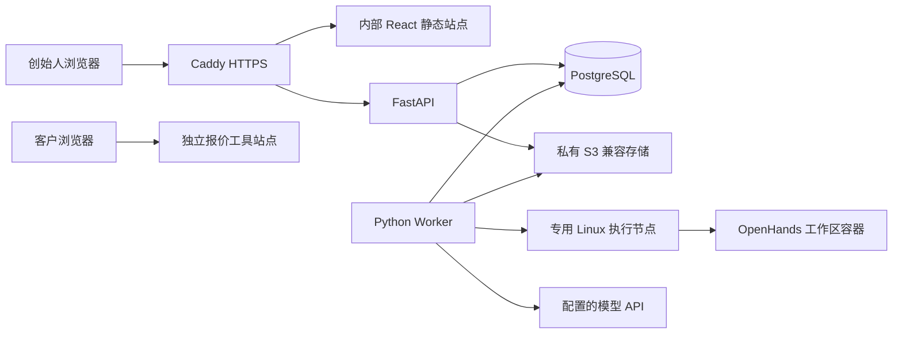

# OneFDE 首版部署设计

状态：推荐部署基线，尚未公网部署；C0+C1a 已有本地 PostgreSQL Compose、uv 锁与可执行启动/迁移命令，尚无生产 Dockerfile 或发布命令。本稿定义后续需要实现和记录的环境及操作顺序，不把配置计划当运行手册成果。技术选择见[架构](../architecture/architecture.md)。

## 拓扑与职责

首版控制节点运行 Caddy、API 和 PostgreSQL（Compose）；前端由 Caddy 服务。专用执行节点运行可信 Python Worker 与受控工程工作区：Worker 直接在当地调用 DockerWorkspace，通过私网/受认证隧道以受限服务身份访问控制数据库和对象存储。两端共用应用领域服务包与精确版本，但生成代码容器不继承 Worker 的环境与凭据。不额外开发远程 Runner 服务，不把 Docker daemon 或 Agent Server 无认证暴露公网。SDK 模型调用可由执行进程发出，图不是强制模型代理。

推荐 Ubuntu 24.04 LTS；Docker Engine/Compose 固定受支持版本。数据库仅在内部网络监听，API 经 Caddy `/api` 同源访问；生产前端不直接访问数据库或执行端。客户静态工具用独立站点根目录与域名，不能通过路径访问内部工作台文件。模型与对象存储服务按实际可用账号和区域配置，不在本轮开通资源。[Docker 安装支持](https://docs.docker.com/engine/install/ubuntu/)、[Compose 使用范围](https://docs.docker.com/compose/intro/features-uses/)

## 配置与凭据

| 配置组 | 实施时记录的值 | 保管位置 |
| --- | --- | --- |
| 平台 | 公共 URL、可信 Origin、cookie 设置、数据库连接、会话过期 | 控制节点受限配置/secret 文件，不提交仓库 |
| 模型 | base URL、model ID、secretRef、工具能力与提供者参数、精确 SDK/镜像版本 | 不可变 ModelProfile 修订；密钥单独保管 |
| 执行 | 执行端私网地址、认证、持久卷、运行时间/调用/资源/并发限额 | Worker 与执行节点，不交给客户工具 |
| 对象 | endpoint、region、私有桶、最小权限凭据、保留策略 | 控制端；不发完整桶权限给浏览器 |
| 发布 | 独立站点、产物版本、目标凭据、回退版本、域名/有效期 | 受控发布操作，不注入任意工程 shell |

首轮小任务默认建议一个活动工程 Run、15 分钟、20 次模型调用、最多 2 次暂态重试且计入总调用数。CPU/内存、出网、实际费用或账号额度必须在接入时填写并记录；大任务另设明确上限。凭据未准备好时可开发确定性部分，不发起真实模型或付费资源操作。

## 单账号访问

首次部署从受限配置创建创始人账号，使用 Argon2id 保存密码摘要，无公开注册。会话使用随机不透明 token，数据库只保留摘要；建议绝对有效期 8 小时，到期重新登录。Cookie 使用 `__Host-onefde_session`、Secure、HttpOnly、Path=/、SameSite=Lax，不设 Domain；生产必须 HTTPS。登录/会话响应设置 Cache-Control: no-store，登录有速率限制，错误不泄露用户名是否存在。

状态变更要求 JSON 请求、可信 Origin 和同步 CSRF token 请求头；token 通过登录/会话 JSON 获取，不放 URL、日志或 session Cookie。登录尚无会话时校验 Origin 与 JSON Content-Type；登出吊销服务端会话。CORS 不使用凭据加通配 Origin。首版本机开发 Cookie 策略通过单独配置明确，不把生产 Secure 设置悄悄关掉。[OWASP 会话](https://cheatsheetseries.owasp.org/cheatsheets/Session_Management_Cheat_Sheet.html)、[CSRF](https://cheatsheetseries.owasp.org/cheatsheets/Cross-Site_Request_Forgery_Prevention_Cheat_Sheet.html)

## 工作区与文件

四角色共用控制基础设施时仍按本次角色/工作/用途过滤资料；Knowledge 服务凭据不作为扩大请求方可见范围的通道。业务资料、Capability元数据和文件/代码引用都要保留归属，公开案例使用获准版本/视图；摘要和日志仍受来源限制。检索前过滤、输出与下载再核对，具体规则见[知识服务约定](../../capability-library/README.md)。这些细粒度资料权限是后续角色接入要求，不据此声称当前C0+C1a已实现全部授权能力。

生成代码不获得宿主 Docker socket、平台数据库、对象桶或部署密钥。工作目录与 Session 卷按任务归属；只挂载指定资料，固定基础镜像，落实资源和出网限制。普通角色没有任意终端。可信执行管理进程可能需要 Docker 权限，因此必须留在专用执行节点，不与个人文件或控制数据库同宿主。

RemoteConversation 的模型配置可能随 Agent Server 进入工程容器；不能声称 SDK 会天然把同容器内的模型密钥与任意终端彻底隔离。首版为执行配置单独的受限模型凭据与调用额度，不使用可管理平台/账户的高权限凭据；若后续要求工程代码无法接触任何模型密钥，再专门引入受控模型出口，不把这一更强保证写成现成能力。

工作区源码、检查结果和必要日志在回收前导出；Session 持久路径显式配置并受限访问。对象 key 由服务端生成，保留摘要、大小和项目归属。下载 API 经会话与项目范围校验后签发默认 5 分钟的只读 URL；URL 在到期前可能多次使用，避免写入日志，不能称为一次性链接。[S3 预签名机制](https://docs.aws.amazon.com/AmazonS3/latest/userguide/using-presigned-url.html)

业务待答不让 Worker 空等：保存 Git 基准/修改快照、产物、必要 Session 和关联问题，确认工程命令及后台写入已停止后结束当轮 Run、释放执行名额。原 Task 与工作区归属保留；后续 Run 取得该任务独占写权限再恢复。现场失联仍保留 interrupted 占用。容器上下文退出会清理，因此恢复材料必须在清理前导出，不能承诺仅有 ID 就能恢复。

## 首次上线顺序与证据

1. 实现并锁定 uv/pnpm 依赖、容器镜像、配置样例和 Compose；核对所选 OpenHands SDK 与 Agent Server 版本。当前这些文件均未生成。
2. 准备控制/执行环境、对象桶和可信域名，填写费用/调用及资源上限。Caddy 公共证书需要满足域名和可达条件，本机内部证书与公共可信证书分开处理。[Caddy HTTPS](https://caddyserver.com/docs/automatic-https)
3. 创建数据库并运行已审阅 Alembic 迁移，配置账号和密钥；先启动控制 API/Worker，再核对数据库健康与执行端连接。开放端口按实际发布配置检查，不能只假设主机防火墙覆盖 Docker 发布端口。
4. 使用官方工作区示例做一次真实文件/工具小任务，登记模型配置、Run、产物和检查。随后执行首个 OneFDE 纵向切片及登录、重复启动/取消等自有逻辑检查，不重跑整个上游测试集。
5. 发布固定前端/后端版本，实际访问内部入口；报价工具另发布固定静态构建，检查样例、限制说明和下载/导出。记录代码/镜像摘要、迁移版本、访问时间及已知限制。

## 备份、升级与恢复

演示阶段默认每日数据库备份、保留 7 日，并在迁移前额外备份；对象产物启用版本或不可变 key，保留与数据库引用一致。密钥通过独立机制保存。真实资料的保留/删除期限待 Q05 确认，不能默认套用演示期限。Session/Workspace 只有需要恢复的部分才备份，不声称每日备份能恢复最后一天所有运行。

升级前停止新派发，确认活动 Run 或记录 interrupted，备份数据库，执行迁移后发布应用。回退使用固定上个镜像/前端；破坏性数据库迁移不能只靠应用降级恢复，需恢复备份或前向修复。恢复后先核查执行节点和外部副作用，再开放派发；作业租约过期不代表工作区已停止。

首次真实发布前完成一次数据库备份恢复与产物读取检查。深度故障注入和多节点容灾后置；不承诺当前没有测得的 RPO/RTO。实施后在本稿补真实命令、配置文件位置及操作证据，测试要求见[测试场景](testing.md)。

## C0+C1a 本地操作入口

已提供 [后端启动、迁移与凭据配置说明](../../backend/README.md)、`.env.example` 和固定 PostgreSQL 镜像的 Compose；仅本机回环数据库端口与 API。实际检查见 [验证记录](c0-c1a-verification.md)。本文件其余控制/执行节点、桶、Caddy、备份恢复和公网发布步骤仍未执行，不能据本地切片声明上线。

## C2当前可执行入口

新增独立Worker CLI、`.env.worker.example`、精确SDK可选依赖及Agent Server镜像digest，操作见 [Worker手册](../../backend/WORKER.md)。当前Windows个人宿主不符合专用Linux执行节点要求，未创建该节点/网络/提供方配额，未调用真实模型；环境检查以非零退出报告具体缺项。已执行的PostgreSQL/SDK绑定/HTTP检查见 [C2验证](c2-verification.md)。

本轮仅落私有本地不可变产物与Session，不宣称S3、签名下载、备份恢复或生产部署完成。SDK Session加密密钥在Worker私有目录单独保管，不挂载工程容器；真实模型密钥按secret_ref在受信任Worker解析，只有单独受限的模型凭据随RemoteConversation配置进入Agent Server，不能扩大为数据库/部署权限。网络名称/确认开关不建立防火墙，生产前必须实际核验隔离和出网。
