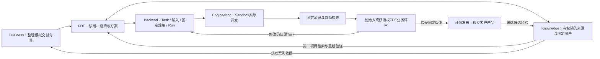

# OneFDE 黑客松实施方案

2026年11月4日，用户确认“按这个方案推进，先同步相关文档和实施计划”。适用：确定参赛切片、角色开发优先级、演示和交付标准时。**参赛方向与开发顺序已确认，具体能力仍按代码和执行证据验收；本轮只同步文档**。业务字段/换算/精度等未决细节不因整体方案确认而自动确定。用户未指定赛事细则，按创始人主导、时间有限、强调可运行AI产品的通用黑客松设计；不预设真实评分权重、截止时间或必须使用的赞助商工具。

需求依据：[PRD](PRD.md)、[报价案例](../../engagements/demo-supplier-quotes/brief.md)、[角色与能力库边界](../../capability-library/README.md)。技术与物理边界继续采用[架构](../architecture/architecture.md)及[单ECS部署设计](../operations/deployment.md)。顺序/当前状态以[实施计划](../development/implementation-plan.md)为准，行为验收以[黑客松验收](../operations/testing.md#黑客松切片验收)为准；本文维护参赛设计与研究依据。本轮不调用模型、启动工程任务、修改业务代码、购买或部署云资源；后续真实执行仍落实当次范围和费用，公开部署仍另行授权。

## 参赛主张

**一个创始人组织AI技术服务团队，把门店的业务问题做成可检查的软件，并将经过整理的能力用于下一次交付。**

主演示限定为：一个模拟水果店报价工具 + 同一Task的一次范围内修改 + 第二个模拟项目中的固定版本复用。OneFDE是创始人管理交付的内部产品；门店使用交付的软件。两者应在演示中分别展示。

核心假设是：需求澄清、真实工具执行、业务评审、持续修改和有依据的复用，比单次生成页面更能体现本项目价值。这是针对OneFDE的参赛判断，不是已验证的市场结论，也不声称其他产品没有这些功能。

## 一手资料与取舍

| 参考 | 可借鉴之处 | 对OneFDE的具体决定 |
| --- | --- | --- |
| [AI Agent Hackathon组织者页面](https://coffee-and-code-agent.devpost.com/) | 工作原型、Agent实际用途、技术实现、价值、可靠性与演示清晰度 | 用真实产物和可追溯操作说明价值；不把该赛事权重当用户比赛规则 |
| [UiPath AgentHack评审说明](https://uipath-agenthack.devpost.com/) | 端到端交付、业务影响、异常处理和演示均被评估 | 准备一条完整业务故事及失败/恢复反例，不能只展示架构图 |
| [Anthropic：Building effective agents](https://www.anthropic.com/research/building-effective-agents) | 区分预定工作流与自主工具循环，从简单组合开始 | FDE做语义组织，程序负责状态/权限；计算与解析用确定性代码，不为角色数量增加自治层 |
| [Anthropic：长任务Harness](https://www.anthropic.com/research/effective-harnesses-for-long-running-agents) | 增量推进、进度记录和真实端到端检查 | 复用Task/Run/固定产物；重点展示一次修改后可继续工作，不重写长任务框架 |
| [OpenHands Docker Sandbox](https://docs.openhands.dev/sdk/guides/agent-server/docker-sandbox) | 已有容器工作区与远程Agent Server | 保留固定1.59.0适配与已有隔离，不照抄最新文档中的浮动镜像或版本参数 |
| [LangGraph Interrupts](https://docs.langchain.com/oss/python/langgraph/interrupts) | 持久化等待外部输入，再继续执行 | 借鉴交互模式，复用现有needs_input/Input采用/新Run；不因此引入LangGraph |
| [Lovable官方介绍](https://docs.lovable.dev/introduction/welcome)、[Bolt官方产品](https://bolt.new/) | 自然语言构建应用、预览与交付体验已较完整 | 对标“用户能操作成果”的体验；OneFDE突出交付组织与版本/复用证据，不只展示生成网页 |

## 当前代码基线与证据边界

- 已有认证、Engagement、Task/Input/Run、派发/租约/停止、版本/评审和固定产物基础；当前工程Task角色仍固定FDE所有者、Engineering执行者。
- Engineering有真实SDK执行适配，已新增上下文/结果契约、工作区漂移检查及固定源码验证。FDE、Business、Knowledge尚无独立角色执行实现；知识目录目前只有约定，没有已验证资产。
- **研究期间最新仓库新增真实网页冒烟记录**：[运行](../operations/evidence/c2-webpage-smoke.json)、[评审](../operations/evidence/c2-webpage-review.json)、[CA记录](../operations/coding-agent-verification.md)。只读核对Task `a2d797a5-ed37-4403-8645-46b26074b125`为succeeded、Run `523cad22-acfd-40e7-9f84-9c739e34afe1`为completed/submitted。
- 该记录采用Compose API + 宿主venv Worker；不能扩大为容器化Worker所有最新代码、四角色协作、业务工具或生产部署都已验收。SDK观测成本0.0也不能当真实账单或免费证明。本研究未运行该脚本，用户在本会话要求不执行模型/C2测试的范围保持不变。

## 目标链路与角色最小能力

下列工具名称仅表达拟实现能力，**不是现有API声明**：

| 角色 | 比赛版本只做的工作 | 最少受控工具与可检查输出 |
| --- | --- | --- |
| Business | 整理一份模拟门店需求，交给FDE；交付后生成有依据的案例草稿 | 读取获准沟通资料/案例、保存交接；输出目标、来源、未知项，不承诺价格/合同，不直接派工程任务 |
| FDE | 澄清业务、形成方案与检查条件，组织工程及一次修改 | 读取项目、创建Task、保存/采用输入、请求执行、查询结果、提出评审；复用现有服务，身份/范围由可信程序注入 |
| Engineering | 在冻结范围内改文件、检查、归档和提交，业务问题回原Task | 复用现有终端/文件工具、SDK与固定源码验证；输出真实命令/退出码、固定源码和问题，不自行接受或获得发布权限 |
| Knowledge | 回答三角色的一次具体咨询，并把首案例中获准内容整理为候选资产 | 受控关键词检索、读取来源/版本、提议资产；返回来源、适用条件、权限、验证状态；第二项目实际检索/采用/重新检查 |

四角色按需调用，可共用同一模型与SDK；不需要四套常驻进程或四个模型厂商。短咨询不强行套入当前engineering-only Task/Run，不为公司级咨询伪造客户项目。新增角色调用入口/工具适配时需补真实权限检查；现有owner_role字符串不是FDE Agent。

若只实现了关键词查询，则如实称“知识检索工具”；要展示Knowledge Agent，须实际有读取证据、分析并调用受控工具的角色实现。其他角色同样不能只靠不同头像或提示词文本冒充能力完成。

## 首个交付及用户界面

报价工具沿用R01—R05：同商品/等级/规格且口径可比才比较；缺信息显示待核对；不计算运费/起订量/送货条件，不自动采购。建议先用同计量单位的小型规范样例，减少未确认换算规则带来的不确定性。

采用CSV优先的最小演示顺序，Excel扩展在样例/规则明确且时间允许后再做；原Excel/CSV目标不因此删除。字段映射、导出样式、重复/无效报价处理和精度仍须明确，**整体方案确认不等于这些业务规则已确定**。价格计算、过滤和导出由普通程序完成，Agent负责理解、澄清及开发。

黑客松工作台范围为三个入口：项目列表含模拟交接入口、一个项目交付详情页、少量能力条目。主详情页展示资料/未知项、FDE方案、当前Task与实际操作摘要、检查结果及固定版本入口。采用/要求修改/接受有明确按钮，不把原始CoT或完整容器日志作为默认产品界面；先做FDE后端与工具，再接薄页面，完整工作台仍后置。交互细节见[关键交互](../design/design.md)。

客户产品单独展示“导入样例→比较/待核对→导出”。生成的HTML/JS不在工作台认证Origin内直接执行；使用独立产品Origin或受限预览。工作台只展示可信元数据及访问入口，避免把产品代码变成管理面脚本。

## 三分钟演示建议（不是赛事规定）

| 时间 | 展示内容 | 必须让观众看到什么 |
| --- | --- | --- |
| 0—20秒 | 模拟门店痛点与样例 | 输入混乱/规格缺失，单看数字不能直接选最低价；模拟标识可见 |
| 20—50秒 | Business交接、FDE澄清一项未知条件 | Agent有来源、有问题，人的答复被明确采用 |
| 50—100秒 | 工程执行摘要、真实检查与客户工具 | 代码和检查来自实际Run，交付工具能操作，范围不明项仍保留 |
| 100—140秒 | 原Task提出一次修改并展示新版本 | 修改有输入/版本关联，旧产物保留；没有另开一个无关聊天重新生成 |
| 140—180秒 | 第二项目使用获准资产，结束价值陈述 | Knowledge返回固定版本，FDE/Engineering采用并重新检查；复用有证据 |

较长生成过程使用真实运行录像并明确标注加速/历史时间/Run ID；现场重点操作成果与一个稳定短流程。准备真实录像和可运行固定版本作为备用，失败时如实切换到历史记录，不伪造实时进度、工具结果或Agent协作。发布尚未完成时写“本地运行原型”，不称已上线。

## 架构与工程取舍

继续模块化FastAPI、PostgreSQL、一个可信Worker、固定OpenHands和按需Sandbox。角色模型只接触自己的受控工具；数据库身份/创始人Cookie/Docker管理命令不进入模型上下文。业务规则确认与公开发布保留人的关键决策，范围内已授权动作可由FDE工具推进，不给每次工具调用再加审批流程。

保留单台ECS+Compose目标；本地先交付可运行演示，再按授权部署。产品从已接受的固定版本通过可信模板发布到独立目录/产品服务，不把生成的任意部署脚本直接当宿主管理命令，也不继续使用工程容器提供客户访问。

比赛版本后置：通用多Agent图编辑器、LLM Router、Kubernetes/Redis、复杂RAG/向量库、完整CRM、完整IDE、自动外呼发信、支付采购、多租户计费。首版资产用少量元数据/普通检索即可，权限过滤在可信服务端执行。

## 开发顺序及退出条件

P0—P4表示参赛实施切片，不是PRD的P01—P10需求编号。具体状态与下一动作仅在[实施计划](../development/implementation-plan.md)维护，确认顺序不表示已执行。

| 顺序 | 建议工作 | 可检查的完成条件 |
| --- | --- | --- |
| P0 | 固定演示样例、业务规则和成功判断，核对已有真实工程证据 | 一组可比/缺失/不可比样例有明确预期；原始资料与假设分开；不再反复做无业务意义的网页冒烟 |
| P1 | 薄FDE及最小项目详情交互 | FDE通过受控工具形成Task；问题/答复/输入采用与当前版本一致；越权动作被拒绝 |
| P2 | 首个报价产品纵向交付 | 从原项目到真实源码/检查/业务评审/可操作产品；一次修改回原Task；模型执行与部署另按当时授权进行 |
| P3 | Knowledge固定资产与第二项目复用，补Business最小交接 | 一个获准候选资产有来源/版本/条件；检索、采用和重新检查有记录；Business案例稿不超授权事实 |
| P4 | 演示稳定性、独立产品入口与参赛材料 | 从干净状态可复现；真实演示录像/运行说明/源码可审阅；如获授权云部署，再验证HTTPS、产品独立性与回退 |

目标是四角色各完成一项可核查工作，优先贯通FDE—Engineering—产品主链。时间不足时，先保住主链、实际产物和修改能力，其他能力按真实状态标注；不把未完成项包装成演示中的全自动功能。

## 评估与比赛价值陈述

- 功能：同口径样例得到约定结果；缺净重/不同等级不会伪造最低价；修改后旧功能回归通过。未确认规则先确认，不能为通过演示自行填补。
- Agent：记录实际工具调用、失败/提问、采用输入和结果；模型自述不算通过，固定源码检查与业务接受分开。
- 复用：记录首资产版本、第二项目引用、适配改动和重新检查；不是只把上轮聊天粘贴到下一轮。
- 隔离：知识权限反例无泄漏；工程停止后产品仍可用；公开示例不含secret/客户原文。
- 效率：分别测请求到可用产物的时间、模型耗时、人工确认次数、实际请求/Token、失败次数及复用范围。没有人工基线不宣称提效倍数，没有账单证据不把SDK的0.0当真实费用。

演讲可用的价值假设：创始人管理问题、范围和交付，Agent承担有证据的执行；每次交付积累可再次使用的能力。暂不承诺“全自动经营公司”、客户收益或付费意愿。先验证创始人交付效率及客户工具可用性，商业化的项目费/维护费或平台收费留待试点验证。
